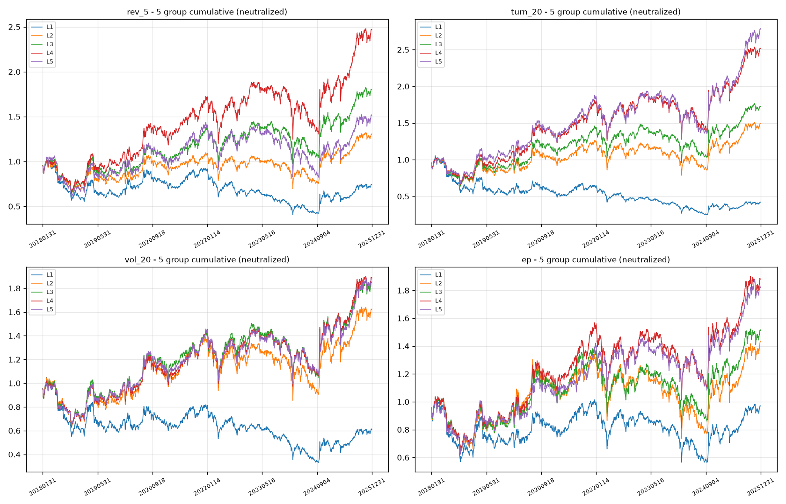

# CSI 1000 Cross-Sectional Equity Research

**A reproducible factor research pipeline for China A-shares**

`2018-01 — 2025-12` · `CSI 1000 universe` · `5-day rebalance`

---

> **TL;DR**
>
> 1. Built a point-in-time, survivorship-bias-free pipeline on CSI 1000 constituents (1,921 trading days, 945–998 stocks/day).
> 2. Four public factors produce **2.01% annual excess** after honest costs (net 7.29%), with a long-short Sharpe of 1.47.
> 3. **The excess is fully explained by value and low-volatility exposures — and the residual alpha is significantly negative** (−4.45%, t = −2.63 before industry control; −6.85%, t = −4.28 after). **This is a smart-beta portfolio that destroys value on a risk-adjusted basis.**
> 4. Two further candidates were built and rejected on pre-registered gates: **accruals** (orthogonal at 0.054, IC 0.009, sign flips in two years) and **PEAD/SUE** (orthogonal at 0.099, IC 0.023 with seven positive years — but no significant portfolio improvement, paired t = −0.27 / +0.66).
> 5. **What did work was implementation.** Industry-scoped score thresholds cut turnover from 2514% to 714% and lifted the industry-neutral portfolio from **0.22% to 4.25% excess** at 12 bp per side. Capacity is roughly **2.4 亿 CNY**; the naive construction is uninvestable at any size.

---

## Contents

- [1. Results](#1-results)
- [2. Core Finding](#2-core-finding-this-is-smart-beta-not-alpha)
- [3. Industry Neutralization](#3-industry-neutralization)
- [4. From a Failed Buffer to a Working Threshold](#4-from-a-failed-buffer-to-a-working-threshold)
- [5. Phase 2: Two Candidates, Both Rejected](#5-phase-2-two-candidates-both-rejected)
- [6. Phase 3: Turnover Control and Capacity](#6-phase-3-turnover-control-and-capacity)
- [7. Method](#7-method)
- [8. Factor Screening](#8-factor-screening)
- [9. Limitations](#9-limitations)
- [10. Roadmap](#10-roadmap)
- [11. Repository](#11-repository)
- [12. Reproduce](#12-reproduce)

---

## 1. Results

### 1.1 Long-only, original convention

*Single-sided cost (12 bp charged once per unit of one-way turnover), fixed weights between rebalances. Kept for continuity with earlier reports; superseded by §1.2.*

| Variant | Ann. Return | Ann. Vol | Sharpe | Max DD | Turnover | Ind. Dev (mean / max) |
|:---|---:|---:|---:|---:|---:|---:|
| **Equal Weight** | **9.79%** | 22.59% | 0.43 | −38.41% | 2394% | 7.37% / 17.50% |
| IC Weighted | 5.86% | 23.26% | 0.25 | −50.74% | 2773% | 8.98% / 20.19% |
| Orthogonalized | 5.75% | 22.27% | 0.26 | −39.75% | 2477% | 7.12% / 19.50% |
| EW + Buffer | 9.13% | 22.17% | 0.41 | −38.88% | 1214% | 6.93% / 15.49% |
| **EW + Stratified** | **8.09%** | 22.09% | 0.37 | −38.48% | 2473% | **1.26% / 1.35%** |
| *Benchmark (EW universe)* | *5.18%* | *24.63%* | — | — | — | — |

### 1.2 Restated: two-sided cost, buy-and-hold weights

*Every trade is charged (sell 14.2% costs 12 bp, buy 14.2% costs another 12 bp). Weights drift naturally between rebalances. **This is the convention used everywhere below.***

| Configuration | Turnover | Gross | Cost | **Net** | **Excess** | Ind. Dev (max) |
|:---|---:|---:|---:|---:|---:|---:|
| EW Baseline | 2437% | 13.75% | 5.86% | 7.29% | **2.01%** | 17.50% |
| EW + threshold | 619% | 10.77% | 1.49% | 9.14% | 3.77% | 16.60% |
| Stratified Baseline | 2514% | 11.96% | 6.05% | 5.41% | **0.22%** | 1.35% |
| **Stratified + threshold** | **714%** | 11.54% | **1.72%** | **9.65%** | **4.25%** | **1.35%** |

> Gross is geometric annualised; cost is arithmetic annualised. They do not subtract exactly.
> **The headline in earlier versions of this file (9.79% / 4.38% excess) understated costs by half.** The revision is decomposed in §6.6.

### 1.3 Pure alpha (long-short diagnostic, gross)

| Variant | Ann. | Vol | Sharpe | Max DD |
|:---|---:|---:|---:|---:|
| Equal Weight | 27.18% | 18.50% | **1.47** | −17.33% |
| IC Weighted | 14.22% | 18.09% | 0.79 | −18.61% |
| Orthogonalized | 15.14% | 18.57% | 0.81 | −17.73% |

> Individual-stock shorting is not implementable in A-shares. Shown for factor validation only.

### 1.4 Annual returns (net, original convention, %)

| | 2018 | 2019 | 2020 | 2021 | 2022 | 2023 | 2024 | 2025 |
|:---|---:|---:|---:|---:|---:|---:|---:|---:|
| Equal Weight | −15.25 | 13.06 | 9.66 | 16.95 | −3.00 | −0.26 | 2.97 | 28.28 |
| IC Weighted | −22.13 | 12.61 | 4.98 | 17.17 | −6.88 | 2.45 | 1.56 | 25.77 |
| Orthogonalized | −16.28 | 10.62 | 8.80 | 9.57 | −3.66 | −1.44 | 3.27 | 20.63 |
| EW + Buffer | −14.60 | 12.45 | 8.60 | 18.15 | −4.46 | 0.23 | 1.77 | 27.22 |
| EW + Stratified | −13.82 | 12.82 | 6.87 | 15.78 | −5.34 | 1.89 | 1.92 | 22.17 |

---

## 2. Core Finding: This Is Smart Beta, Not Alpha

Excess return regressed on style factor premiums (no market term). Costs are charged on every trade (two-sided, 12 bp per side) and weights drift between rebalances:

| | A: industry uncontrolled | B: industry controlled |
|:---|---:|---:|
| **alpha (ann.)** | **−4.45%** | **−6.85%** |
| **alpha t-stat** | **−2.63** | **−4.28** |
| size β | 0.0021 (t=0.28) | −0.0002 (t=−0.02) |
| value β | **0.2979** (t=17.46) | **0.2813** (t=17.43) |
| low-vol β | **0.2774** (t=24.60) | **0.3281** (t=30.74) |
| R² | 0.526 | 0.595 |

Both alphas are significantly **negative**. This is a stronger statement than "no alpha": after removing value and low-volatility exposure, the portfolio destroys value rather than merely failing to add it.

Style factor premiums over the same window:

| Factor | Ann. Return |
|:---|---:|
| size (small − large) | 6.45% |
| value (high EP − low EP) | 7.78% |
| low-vol (low σ − high σ) | **13.08%** |

**Interpretation.** The excess is value plus low-volatility exposure. Strip those two and the strategy returns nothing — in fact less than nothing.

An independent test: the composite score is residualized daily against size, value and volatility, and the residuals are rebalanced into a fresh portfolio.

| | Original | Style-neutral | Benchmark |
|:---|---:|---:|---:|
| Net return (ann.) | 7.29% | **−5.33%** | 5.18% |
| Excess (ann.) | +2.01% | **−9.71%** | — |
| Residual alpha | −4.45% (t=−2.63) | −5.43% (t=−1.86) | — |

> Two different methods — portfolio construction and return-level regression — reach the same conclusion. The finding is robust.

### What industry control does *not* change

| Exposure | A (uncontrolled) | B (controlled) | Industry contribution |
|:---|---:|---:|---:|
| value β | 0.298 | 0.281 | **6%** |
| low-vol β | 0.277 | 0.328 | **−18%** (rose) |

Value and low-volatility loadings are **stock-level, not industry-driven**. Controlling industry does not remove them; if anything it makes the low-vol loading purer.

**Consequence:** residual alpha goes from −4.45% to −6.85% and the t-stat from −2.63 to −4.28. The industry bets in the uncontrolled portfolio were partly masking weak stock selection — once removed, the negative alpha becomes unambiguous.

---

## 3. Industry Neutralization

Top-N equal weighting leaves industry exposure uncontrolled: maximum deviation from the benchmark reaches **17.5%**, driven by two sectors that stay overweight for years.

| Industry | Times it was the largest deviation | Average deviation |
|:---|---:|---:|
| 电气设备 | 76 | **+8.99%** |
| 化工原料 | 64 | **+8.19%** |
| 汽车配件 | 23 | +6.98% |
| 软件服务 | 34 | +2.10% |

Replacing top-N with **stratified sampling** — quotas allocated to each industry in proportion to its benchmark weight, stocks selected by score within each bucket — caps the deviation at **1.35%**.

| | Excess (restated) | Ind. Dev (mean / max) |
|:---|---:|---:|
| Top 50, equal weight | 2.01% | 7.37% / 17.50% |
| Top 50, stratified | 0.22% | **1.26% / 1.35%** |

**Industry control looks expensive — until turnover is fixed.** The stratified portfolio gives up 1.8 pp of excess to achieve a defensible risk profile. But after Phase 3's threshold rule it earns **4.25%** at 1.35% deviation, beating the unconstrained version outright (§6).

---

## 4. From a Failed Buffer to a Working Threshold

An earlier attempt to cut turnover used a **rank-band buffer**: hold any name still ranked inside the top 100 instead of re-selecting the top 50.

| | Turnover | Cost | Ann. Return |
|:---|---:|---:|---:|
| Top 50, no buffer | 2394% | 2.87% | **9.79%** |
| Top 50, buffer to 100 | 1214% | 1.46% | **9.13%** |

Turnover and cost both halved, yet net return fell 0.66%. The reason: a rank band grants **unconditional** tenure. A stock ranked 90th keeps its seat even when it would never have been bought, and the factor's IC decays ~70% within five days — so the portfolio accumulates stale positions.

Phase 3 replaced it with two changes, and together they work:

1. **Score-difference threshold instead of a rank band.** A held name survives only if its score is within Δ (0.25 cross-sectional σ) of the selection cutoff.
2. **Industry-scoped instead of global.** The threshold is applied *inside each industry quota*, so hysteresis cannot drift the portfolio into a few sectors.

The first change alone still failed: applied globally, maximum industry deviation blew out from 1.35% to **15.80%**, and the portfolio became a bet on 化工原料 (+8.80%), 元器件 (+8.92%) and 专用机械 (+9.63%). Scoping the threshold to industry quotas fixed it — deviation returned to **1.35%** exactly, because the quotas are identical to the unmodified selector.

---

## 5. Phase 2: Two Candidates, Both Rejected

### 5.1 Accruals (Sloan 1996)

    accruals = (net income − operating cash flow) / average total assets   [TTM]
    factor   = −accruals                     (low accruals = high score)

Point-in-time throughout: earliest `f_ann_date` per period (no restatement look-ahead), latest announcement date across the three statements, `allow_exact_matches=False` so signals only trade the day after disclosure. Banks, insurers and brokers dropped.

Coverage **96.0%** of the panel. Cost: 17,088 API calls, 92 minutes with 8 threads.

| Test | Result | Gate | |
|:---|---:|---:|:---|
| Correlation with 4 factors | max **0.054** | < 0.30 | ✅ |
| Rank IC | **0.0093** | ≥ 0.02 | ❌ |
| ICIR | 0.140 | ≥ 0.30 | ❌ |
| Yearly IC sign | **2 of 8 years negative** | same sign | ❌ |
| Quintile monotonicity | Q5 < Q4 | monotone | ❌ |

The orthogonality is the interesting part: at 0.054 the accrual dimension is genuinely uncovered. But the signal has the wrong shape — +0.0258 in 2018 and +0.0274 in 2023, but **−0.0068 in 2020 and −0.0069 in 2025**. Quintile means rise to 20.6 bp at Q4 then fall to 17.8 bp at Q5, while the median is negative in all five buckets. **Rejected.**

### 5.2 PEAD / SUE

    single-quarter net income ni_q
      → YoY growth g = (ni_q_t − ni_q_{t−4}) / |ni_q_{t−4}|
      → SUE = (g_t − mean(g, last 8 quarters)) / std(g, last 8 quarters)
      → event date = f_ann_date, signal valid 90 calendar days

Coverage **58.8%** of in-universe rows. Cross-sectionally this is much better than accruals:

| Test | Result | Gate | |
|:---|---:|---:|:---|
| Correlation with 4 factors | max **0.099** | < 0.30 | ✅ |
| IC, 20-day forward | **0.0229** | ≥ 0.02 | ✅ |
| IC, 60-day forward | 0.0297 | ≥ 0.02 | ✅ |
| Yearly IC (20-day) | **7 of 7 positive** | same sign | ✅ |
| Quintile means (20-day) | 9.6 → 17.3 → 19.8 → 20.4 → 26.9 bp | monotone | ✅ |
| Residual IC after the 4 factors | **0.0300** | ≥ 0.015 | ✅ |

**The portfolio test is where it fails.**

| Construction | Excess | IR | Paired test vs baseline |
|:---|---:|---:|---|
| Equal Weight (4 factors) | 4.38%* | 0.663* | — |
| EW + SUE | 3.96%* | 0.620* | t = −0.27, 95% CI [−2.75%, +2.06%] |
| EW + Stratified | 2.77%* | 0.409* | — |
| EW + SUE + Stratified | 3.43%* | 0.533* | t = +0.66, 95% CI [−1.37%, +2.62%] |

\* measured under the original cost convention; the paired tests are internally consistent regardless of the level.

**Why the cross-section looks good and the portfolio does not:**

1. **Turnover barely moves** (23.94% → 24.00%). The top-50 holdings are essentially unchanged — stocks at the top carry ±2–3 z-scores on `rev_5` and `vol_20`, which SUE's ±1 cannot reorder.
2. **Horizon mismatch.** The portfolio rebalances every 5 days; SUE's signal lives on a 20–60 day scale.
3. **58.8% coverage.** 40% of candidates get no tilt at each rebalance.
4. **The improvement is concentrated** — under the stratified construction 2020 alone contributes +7.12 pp; 2022, 2023 and 2025 are negative.

**Rejected.**

### 5.3 What the two failures have in common

| | Accruals | PEAD / SUE |
|---|---|---|
| Orthogonal to existing factors | ✅ 0.054 | ✅ 0.099 |
| Cross-sectional IC | ❌ 0.009 | ✅ 0.023 |
| Time-series stability | ❌ 2 years negative | ✅ 7 years positive |
| Portfolio improvement | — | ❌ not significant |
| **Failure mode** | **signal too weak** | **signal real, untradeable at this horizon** |

**Cross-sectional significance is not the same as tradable excess return.** Between the two sit three walls: coverage, Top-N truncation, and rebalancing frequency.

---

## 6. Phase 3: Turnover Control and Capacity

### 6.1 Diagnosis

The baseline replaces **23.8 of 50 names every 5 trading days** — 2437% annual turnover. Decomposition:

| Source | Share of turnover |
|:---|---:|
| New names entering | **98%** |
| Weight re-normalisation | 2% |

So weight-drift tolerance is useless; the problem is entirely at the selection boundary. With an IC that peaks at the 1-day horizon, the 50th rank is close to noise.

### 6.2 The rule

    for each industry i:
        k     = quota (identical to the unmodified stratified selector)
        cut   = score of the k-th best stock in industry i
        floor = cut − 0.25 × (cross-sectional std of score)
        keep  = held names in i with score >= floor, capped at k
        fill  = remaining seats from the highest-scoring names in i

Quotas are conserved exactly, so industry neutrality is unchanged by construction. Turnover falls because names just below the cutoff are retained *within their own industry*, never across industries.

### 6.3 Sensitivity to Δ

| Δ (× σ) | Turnover | Replacement / period | net@30bp | ex@30bp |
|---:|---:|---:|---:|---:|
| 0.10 | 954% | 8.9 | 5.59% | +0.40% |
| 0.15 | 858% | 8.0 | 6.21% | +0.98% |
| **0.25** | **714%** | **6.5** | **6.87%** | **+1.61%** |
| 0.35 | 609% | 5.5 | 8.17% | +2.85% |
| 0.50 | 505% | 4.4 | 7.50% | +2.21% |

Adjacent steps change net@30 by at most 1.30 pp — there is no cliff. Every setting beats the baseline (−3.72% net@30) by at least 9.3 pp. **The default is fixed at 0.25 and not tuned**; 0.35 is the in-sample maximum and is deliberately not used.

Note the shape: `net@30` rises as Δ increases because turnover (hence cost) falls. That is mechanical, not a sign of instability. The drop from 0.35 to 0.50 is where stale-position alpha loss overtakes the cost saving.

### 6.4 Attribution: how much of the gain is signal?

Two placebos separate the mechanisms.

| Configuration | Turnover | net@30bp |
|:---|---:|---:|
| Baseline | 2514% | −3.72% |
| Scores lagged 60 days | 735% | **4.30%** |
| Live scores, Δ=0.25 | 714% | **6.87%** |

The two lower rows have nearly identical turnover, which makes the comparison clean:

- **Cost effect = +8.03 pp** — achievable with two-quarter-old rankings; pure mechanical saving.
- **Signal effect = +2.57 pp** — the incremental value of score freshness at matched turnover.
- Sum: +10.59 pp, matching the observed total exactly.

A second placebo (randomly permuting scores within each date) destroys time persistence: turnover jumps to 4478% and excess falls to −21.98%, confirming that the turnover reduction depends on the signal being persistent rather than on the rule alone.

**Roughly three quarters of the improvement is cost, one quarter is signal.** This is stated plainly because the strategy is a cost story, not a discovery story.

### 6.5 Capacity

Square-root impact model: `rate = 0.7 × σ_daily × sqrt(Q / ADV) + 3 bp`, with σ and ADV computed over the prior 20 days only.

| AUM | Stratified + threshold | Baseline |
|---:|---:|---:|
| 1 亿 | **+1.91%** | −5.55% |
| 2 亿 | +0.42% | −10.18% |
| 3 亿 | −0.71% | −13.57% |

**Capacity is about 2.4 亿.** The naive construction has negative excess at every size tested — it is not an investable product at any scale, only a research artifact.

### 6.6 Revision of the headline

| Convention | EW net return |
|:---|---:|
| Original: fixed weights, single-sided cost | 9.79% |
| + buy-and-hold weights | 10.48% |
| + two-sided cost (**final**) | **7.29%** |

The cost convention alone accounts for about −2.9 pp. Phase 1's reported 4.38% excess is **2.01%** under the corrected convention, and its residual alpha moves from −2.18% (t=−1.35, insignificant) to **−4.45% (t=−2.63, significant)**.

---

## 7. Method

**Data** — Tushare Pro: `daily`, `daily_basic`, `adj_factor`, `index_weight`, `stock_basic`, `namechange`, plus `income` / `cashflow` / `balancesheet` for Phase 2. 2018–2025.

**Universe** (rebuilt every trading day)

    CSI 1000 point-in-time constituents     (96 monthly snapshots)
      ∩ listed ≥ 60 trading days
      ∩ non-ST                                (from name-change history)
      ∩ traded that day                       (proxy for non-suspension)
      ∩ amount > 0

→ 945–998 stocks/day across 1,921 trading days.

**Factors (4)** — 5-day reversal · 20-day turnover · 20-day volatility · earnings yield (1 / PE_TTM)

All sign-aligned so that higher is better: `rev_5 = −5d return`, `turn_20 = −20d mean turnover`, `vol_20 = −20d annualized σ`, `ln_mv = −ln(circulating market cap)`.

**Preprocessing** (daily cross-section)

    MAD winsorization (3 × 1.4826)
      → OLS residualization on industry dummies + log circulating market cap
      → z-score

**Composite** — equal weight. IC-weighted and orthogonalized variants were tested and underperformed.

**Portfolio** — top 50, industry-stratified, 5-day rebalance, buy-and-hold between rebalances, cost charged on every trade.

---

## 8. Factor Screening

Click to expand

| Factor | Raw IC | Neutralized IC | ICIR | Decision |
|:---|---:|---:|---:|:---|
| `rev_5` | 0.0160 | 0.0340 | 0.345 | keep |
| `turn_20` | 0.0168 | 0.0369 | 0.387 | keep |
| `vol_20` | 0.0173 | 0.0382 | 0.377 | keep |
| `ep` | 0.0070 | 0.0170 | 0.222 | keep (weak) |
| `ln_mv` | 0.0037 | — | 0.064 | drop → used as neutralizer |
| `mom_60` | −0.0077 | — | −0.098 | drop (A-share momentum is reversal) |
| `acc_ttm` | 0.0093 | — | 0.140 | **reject — §5.1** |
| `sue` (20d) | 0.0229 | — | 0.264 | **reject — §5.2** |

**Effect of neutralization:** mean Rank IC rises from **0.017** (raw) to **0.035** (neutralized). Most raw predictive power was masked by industry and size exposures.

---

## 9. Limitations

- **The residual alpha is significantly negative, not zero.** After value and low-volatility exposure, the portfolio destroys about 4.5 pp (uncontrolled) to 6.9 pp (industry-controlled) per year. Three independent attempts found no source of alpha.
- **The headline is a cost story.** Roughly three quarters of the Phase 3 gain comes from lower trading costs, not better stock selection (§6.4).
- **Capacity is small.** About 2.4 亿 on CSI 1000 mid-caps with a 5-day rebalance. This is a self-managed book, not an asset-management product.
- **Freshness beats breadth, and it is fragile.** The usable Δ range is 0.25–0.50; at 0.10 the strategy barely clears 30 bp costs.
- **The impact model is conservative.** Orders are assumed executed in a single day; real desks spread them over 2–3 days, which lowers impact but costs signal.
- **Industry classification is current, not point-in-time** (136 categories, minor look-ahead).
- **Upstream data has known bad rows.** Beijing Stock Exchange `.BJ` `pct_chg` contains absurd values (max 200,400%; 3.0% of all rows). Outside CSI 1000, so it never enters the sample, but any full-market computation must filter to `.SH` / `.SZ`.
- **Fundamental data is as-reported-at-first-announcement.** Conservative, but not identical to a vendor's point-in-time database.
- **Everything above is in-sample.** The 2018–2025 window has been used exhaustively; no out-of-sample validation exists yet.

### 9.1 Out-of-sample status

The full sample has been used for factor construction, attribution, three candidate tests, and the turnover study. **No part of 2018–2025 is out of sample.** Any new configuration must be validated once, and only once, on data from 2026-01 onward.

---

## 10. Roadmap

| | Item | Status |
|:---|:---|:---|
| Phase 1 | Factor research + attribution | ✅ complete |
| Phase 2a | Accruals factor | ❌ tested, rejected |
| Phase 2b | PEAD / SUE | ❌ tested, rejected |
| Phase 3 | Turnover control + capacity | ✅ complete |
| Phase 4 | Attribution restated under two-sided cost | ✅ complete |
| — | Live paper-trading record | not started |
| — | Alternative data (analyst revisions) | parked — needs a 10000-point tier |

**Repositioning.** With no alpha across three attempts, the remaining value is not in factor discovery but in **delivery**: controlling exposures, halving turnover, and modelling impact honestly. The project's contribution is a candid measurement of what a public-data CSI 1000 strategy can and cannot do.

---

## 11. Repository

    01_pull_history.py         raw fetch (resumable, per-year parquet)
    02_pull_ref.py             stock list / delisted / name changes
    02b_pull_namechange.py     yearly chunking (10k row API cap)
    03_build_universe.py       point-in-time tradable universe
    04_build_factors.py        factor construction
    05_single_factor_test.py   IC / quintile / decay
    06_preprocess_factors.py   winsorize + neutralize + z-score
    07_backtest.py             portfolio construction, cost, five variants
    08_attribution.py          A/B attribution (two-sided cost, buy-and-hold)
    09_style_neutral_test.py   style-neutral diagnostics (two-sided cost)
    10_pull_fina.py            Phase 2: three-statement fetch (8 threads)
    11_build_accruals.py       Phase 2a: accruals factor
    12_check_accruals.py       Phase 2a: correlation / IC / quintile gate
    14_build_pead.py           Phase 2b: SUE factor
    15_check_pead_horizon.py   Phase 2b: IC at 5/20/60d
    16_check_pead_marginal.py  Phase 2b: residual IC, composite comparison
    16b_check_selection.py     Phase 2b: subsample selection-bias check
    18_significance.py         Phase 2b: paired significance test
    19_diagnose_holdings.py    Phase 3: turnover / industry / size diagnostics
    20_turnover_control.py     Phase 3: smoothing vs threshold
    24_diagnose_ab.py          Phase 3: does hysteresis break neutrality?
    25_turnover_quota.py       Phase 3: quota-conserving threshold
    26_sensitivity.py          Phase 3: Δ sensitivity + placebo attribution
    27_impact_cost.py          Phase 3: square-root impact, capacity curve
    28_fix_cost_convention.py  Phase 3: two-sided cost, restated numbers
    RESEARCH_LOG.md            decisions, negative results, engineering lessons
    PROJECT_STATUS.md          current state, for handoff

---

## 12. Reproduce

    pip install -r requirements.txt
    echo "TUSHARE_TOKEN=your_token" > .env

    python 01_pull_history.py        # ~60 min, resumable
    python 02_pull_ref.py
    python 02b_pull_namechange.py
    python 03_build_universe.py
    python 04_build_factors.py
    python 05_single_factor_test.py
    python 06_preprocess_factors.py
    python 07_backtest.py
    python 08_attribution.py         # two-sided cost
    python 09_style_neutral_test.py  # two-sided cost

Phase 2 (reproduces §5):

    python 10_pull_fina.py           # ~92 min, 8 threads
    python 11_build_accruals.py
    python 12_check_accruals.py
    python 14_build_pead.py
    python 15_check_pead_horizon.py
    python 16_check_pead_marginal.py
    python 16b_check_selection.py
    python 18_significance.py

Phase 3 (reproduces §6):

    python 19_diagnose_holdings.py
    python 20_turnover_control.py
    python 24_diagnose_ab.py
    python 25_turnover_quota.py
    python 26_sensitivity.py
    python 27_impact_cost.py
    python 28_fix_cost_convention.py

---

## Data & Disclaimer

Data via Tushare Pro. Independent research project for educational purposes, not investment advice. **No live trading record exists.**
