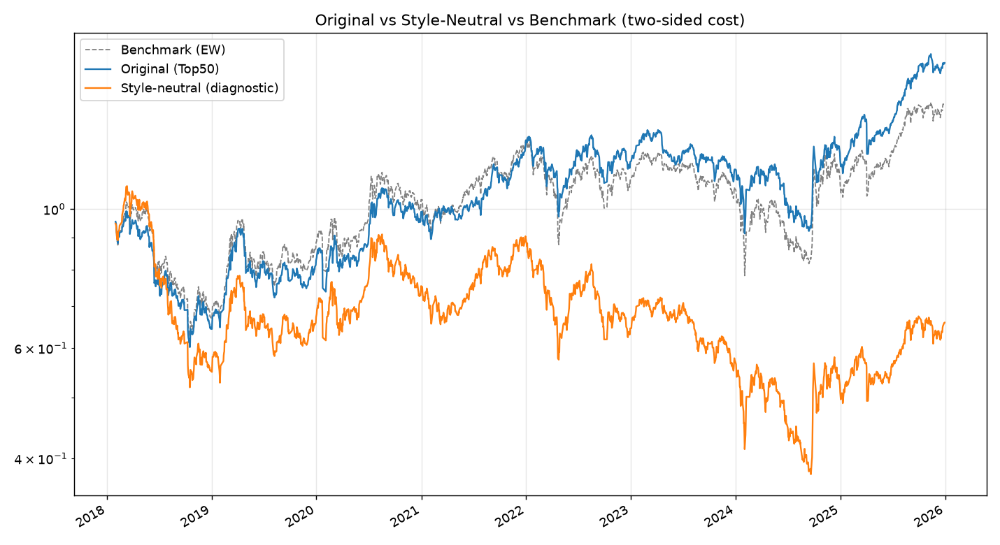

# CSI 1000 Cross-Sectional Equity Research

**A reproducible factor research pipeline for China A-shares**

`2018-01 — 2025-12` · `CSI 1000 universe` · `5-day rebalance`

---

> **TL;DR**
>
> 1. Built a point-in-time, survivorship-bias-free pipeline on CSI 1000 constituents (1,921 trading days, 945–998 stocks/day; **2,364 names** ever entered the index).
> 2. Four public factors produce **2.01% annual excess** after honest costs against an equal-weight benchmark (net 7.29%), with a long-short Sharpe of 1.47.
> 3. **The excess is fully explained by value and low-volatility exposures — and the residual alpha is significantly negative** (−4.45%, t = −2.63 before industry control; −6.85%, t = −4.28 after).
> 4. Two further candidates were built and rejected on pre-registered gates: **accruals** (orthogonal at 0.054, IC 0.009, sign flips in two years) and **PEAD/SUE** (orthogonal at 0.099, IC 0.023 with seven positive years — but no significant portfolio improvement, paired t = −0.27 / +0.66).
> 5. **What did work was implementation.** Industry-scoped score thresholds cut turnover from 2514% to 714% and lifted the industry-neutral portfolio from **0.22% to 4.25% excess**. Tracking error is **7.06%**, of which **77.2% comes from stock selection and only 4.2% from industry**. Capacity is about **2.4 亿 CNY**.
> 6. Against the **cap-weighted CSI 1000 index** — the benchmark a product would be measured against — the portfolio earns **9.65%** with **8.05% excess** and **IR 0.90**. But it decomposes entirely into known premia: **~3.70pp size gap + ~4.25pp style exposure + ≈0 residual alpha**.
> 7. The pipeline runs **daily**; the live selector reproduces the 385-period replay **exactly (50/50 names)**. A paper-trading record began **2026-11-20** (NAV 1.0, cold start) — the project's first genuine out-of-sample evidence.
> 8. **Replicated five classic anomalies** (short-term reversal, Amihud illiquidity, MAX, 52-week high, turnover) on the CSI 1000. **4/4 replicate at their own horizons, 3/4 at the 5-day production frequency — but none of them adds anything**: residual IC all below 0.015 and marginal t all below 2. The exposures were already inside the portfolio, so the decision was to **add no factor**. See `FACTOR_ZOO.md`.

---

## Contents

- [1. Results](#1-results)
- [2. Core Finding](#2-core-finding-this-is-smart-beta-not-alpha)
- [3. Industry Neutralization](#3-industry-neutralization)
- [4. From a Failed Buffer to a Working Threshold](#4-from-a-failed-buffer-to-a-working-threshold)
- [5. Phase 2: Two Candidates, Both Rejected](#5-phase-2-two-candidates-both-rejected)
- [6. Phase 3: Turnover Control and Capacity](#6-phase-3-turnover-control-and-capacity)
- [7. Method](#7-method)
- [8. Factor Screening](#8-factor-screening)
- [9. Limitations](#9-limitations)
- [10. Roadmap](#10-roadmap)
- [11. Repository](#11-repository)
- [12. Reproduce](#12-reproduce)
- [Appendix A: Legacy Results](#appendix-a-legacy-results-single-sided-cost)

---

## 1. Results

> Final convention: **two-sided cost** (every trade charged 12 bp), **buy-and-hold weights** between rebalances, and **NaN-aware scores** (a stock outside the constituents on a given day is missing, not zero). Earlier single-sided-cost results are in [Appendix A](#appendix-a-legacy-results-single-sided-cost); do not compare the two directly.

### 1.1 Long-only, net of cost

| Configuration | Turnover | Gross | Cost | **Net** | **Excess** | Ind. Dev (max) |
|:---|---:|---:|---:|---:|---:|---:|
| EW Baseline | 2437% | 13.75% | 5.86% | 7.29% | **2.01%** | 17.50% |
| EW + threshold | 619% | 10.77% | 1.49% | 9.14% | 3.77% | 16.60% |
| Stratified Baseline | 2514% | 11.96% | 6.05% | 5.41% | **0.22%** | 1.35% |
| **Stratified + threshold** | **714%** | 11.54% | **1.71%** | **9.65%** | **4.25%** | **1.35%** |
| *Benchmark (EW universe)* | — | *5.18%* | — | — | — | — |

> Gross is geometric annualised; cost is arithmetic annualised — they do not subtract exactly.
> The headline in earlier versions (9.79% / 4.38% excess) understated costs by half. See §6.6.

### 1.2 Pure alpha (long-short diagnostic, gross)

| Variant | Ann. | Vol | Sharpe | Max DD |
|:---|---:|---:|---:|---:|
| Equal Weight | 27.18% | 18.50% | **1.47** | −17.33% |
| IC Weighted | 14.22% | 18.09% | 0.79 | −18.61% |
| Orthogonalized | 15.14% | 18.57% | 0.81 | −17.73% |

> Individual-stock shorting is not implementable in A-shares. Shown for factor validation only.

---

## 2. Core Finding: This Is Smart Beta, Not Alpha

Excess return regressed on style factor premiums (no market term), two-sided cost, drifting weights:

| | A: industry uncontrolled | B: industry controlled |
|:---|---:|---:|
| **alpha (ann.)** | **−4.45%** | **−6.85%** |
| **alpha t-stat** | **−2.63** | **−4.28** |
| size β | 0.0021 (t=0.28) | −0.0002 (t=−0.02) |
| value β | **0.2979** (t=17.46) | **0.2813** (t=17.43) |
| low-vol β | **0.2774** (t=24.60) | **0.3281** (t=30.74) |
| R² | 0.526 | 0.595 |

Both alphas are significantly **negative**. After removing value and low-volatility exposure, the portfolio destroys value rather than merely failing to add it.

Style factor premiums over the same window:

| Factor | Ann. Return |
|:---|---:|
| size (small − large) | 6.45% |
| value (high EP − low EP) | 7.78% |
| low-vol (low σ − high σ) | **13.08%** |

An independent test — residualizing the composite score daily against size, value and volatility, then rebalancing the residuals:

| | Original | Style-neutral | Benchmark |
|:---|---:|---:|---:|
| Net return (ann.) | 7.29% | **−5.33%** | 5.18% |
| Excess (ann.) | +2.01% | **−9.71%** | — |
| Residual alpha | −4.45% (t=−2.63) | −5.43% (t=−1.86) | — |

### What industry control does *not* change

| Exposure | A (uncontrolled) | B (controlled) | Industry contribution |
|:---|---:|---:|---:|
| value β | 0.298 | 0.281 | **6%** |
| low-vol β | 0.277 | 0.328 | **−18%** (rose) |

Value and low-volatility loadings are **stock-level, not industry-driven**. Controlling industry makes the low-vol loading purer, and pushes residual alpha from −4.45% (t=−2.63) to −6.85% (t=−4.28).

---

## 3. Industry Neutralization

Top-N equal weighting leaves industry exposure uncontrolled: maximum deviation from the benchmark reaches **17.5%**, driven by two sectors that stay overweight for years.

| Industry | Times it was the largest deviation | Average deviation |
|:---|---:|---:|
| 电气设备 | 76 | **+8.99%** |
| 化工原料 | 64 | **+8.19%** |
| 汽车配件 | 23 | +6.98% |
| 软件服务 | 34 | +2.10% |

Replacing top-N with **stratified sampling** — quotas allocated to each industry in proportion to its benchmark weight — caps the deviation at **1.35%**.

| | Excess | Ind. Dev (mean / max) |
|:---|---:|---:|
| Top 50, equal weight | 2.01% | 7.37% / 17.50% |
| Top 50, stratified | 0.22% | **1.26% / 1.35%** |

**Industry control looks expensive — until turnover is fixed.** After Phase 3's threshold rule the stratified portfolio earns **4.25%**, and §6.7 shows the industry sleeve consumes only **4.2%** of active risk.

---

## 4. From a Failed Buffer to a Working Threshold

An earlier attempt used a **rank-band buffer**: hold any name still ranked inside the top 100.

| | Turnover | Cost | Ann. Return |
|:---|---:|---:|---:|
| Top 50, no buffer | 2394% | 2.87% | **9.79%** |
| Top 50, buffer to 100 | 1214% | 1.46% | **9.13%** |

*(Legacy convention — shown only to make the mechanism point.)*

Turnover and cost both halved, yet net return fell 0.66%. A rank band grants **unconditional** tenure: a stock ranked 90th keeps its seat even when it would never have been bought, and the factor's IC decays ~70% within five days.

Phase 3 replaced it with two changes that work together:

1. **Score-difference threshold instead of a rank band.** A held name survives only if its score is within Δ (0.25 cross-sectional σ) of the selection cutoff.
2. **Industry-scoped instead of global.** The threshold is applied *inside each industry quota*.

The first change alone still failed: applied globally, maximum industry deviation blew out from 1.35% to **15.80%**. Scoping it to quotas restored 1.35% exactly.

---

## 5. Phase 2: Two Candidates, Both Rejected

### 5.1 Accruals (Sloan 1996)

    accruals = (net income − operating cash flow) / average total assets   [TTM]
    factor   = −accruals

Point-in-time throughout: earliest `f_ann_date` per period, latest announcement date across the three statements, `allow_exact_matches=False` (T+1 entry). Financials dropped. Coverage **96.0%**. Cost: 17,088 API calls, 92 minutes with 8 threads.

| Test | Result | Gate | |
|:---|---:|---:|:---|
| Correlation with 4 factors | max **0.054** | < 0.30 | ✅ |
| Rank IC | **0.0093** | ≥ 0.02 | ❌ |
| ICIR | 0.140 | ≥ 0.30 | ❌ |
| Yearly IC sign | **2 of 8 years negative** | same sign | ❌ |
| Quintile monotonicity | Q5 < Q4 | monotone | ❌ |

Orthogonality at 0.054 says the dimension is genuinely uncovered. But IC is +0.0258 in 2018 and +0.0274 in 2023, **−0.0068 in 2020 and −0.0069 in 2025**. Quintile means rise to 20.6 bp at Q4 then fall to 17.8 bp at Q5, medians negative in all five buckets. **Rejected.**

### 5.2 PEAD / SUE

    SUE = (g_t − mean(g, last 8 quarters)) / std(g, last 8 quarters)
      where g = single-quarter YoY net income growth
      event date = f_ann_date, signal valid 90 calendar days

Coverage **58.8%** of in-universe rows.

| Test | Result | Gate | |
|:---|---:|---:|:---|
| Correlation with 4 factors | max **0.099** | < 0.30 | ✅ |
| IC, 20-day forward | **0.0229** | ≥ 0.02 | ✅ |
| IC, 60-day forward | 0.0297 | ≥ 0.02 | ✅ |
| Yearly IC (20-day) | **7 of 7 positive** | same sign | ✅ |
| Quintile means (20-day) | 9.6 → 17.3 → 19.8 → 20.4 → 26.9 bp | monotone | ✅ |
| Residual IC after the 4 factors | **0.0300** | ≥ 0.015 | ✅ |

**The portfolio test is where it fails.**

| Construction | Excess | IR | Paired test vs baseline |
|:---|---:|---:|---|
| EW + SUE | 3.96%* | 0.620* | t = −0.27, 95% CI [−2.75%, +2.06%] |
| EW + SUE + Stratified | 3.43%* | 0.533* | t = +0.66, 95% CI [−1.37%, +2.62%] |

\* legacy cost convention; paired tests are internally consistent regardless of level.

Turnover barely moves (23.94% → 24.00%). The top-50 holdings are essentially unchanged — stocks at the top carry ±2–3 z-scores on `rev_5` and `vol_20`, which SUE's ±1 cannot reorder. **Rejected.**

### 5.3 What the two failures have in common

| | Accruals | PEAD / SUE |
|---|---|---|
| Orthogonal to existing factors | ✅ 0.054 | ✅ 0.099 |
| Cross-sectional IC | ❌ 0.009 | ✅ 0.023 |
| Time-series stability | ❌ 2 years negative | ✅ 7 years positive |
| Portfolio improvement | — | ❌ not significant |
| **Failure mode** | **signal too weak** | **signal real, untradeable at this horizon** |

**Cross-sectional significance is not the same as tradable excess return.**

---

## 6. Phase 3: Turnover Control and Capacity

### 6.1 Diagnosis

The baseline replaces **23.8 of 50 names every 5 trading days** — 2437% annual turnover.

| Source | Share of turnover |
|:---|---:|
| New names entering | **98%** |
| Weight re-normalisation | 2% |

### 6.2 The rule

    for each industry i:
        k     = quota (identical to the unmodified stratified selector)
        cut   = score of the k-th best stock in industry i
        floor = cut − 0.25 × (cross-sectional std of score)
        keep  = held names in i with score >= floor, capped at k
        fill  = remaining seats from the highest-scoring names in i

### 6.3 Sensitivity to Δ

| Δ (× σ) | Turnover | Replacement / period | net@30bp | ex@30bp |
|---:|---:|---:|---:|---:|
| 0.10 | 954% | 8.9 | 5.59% | +0.40% |
| 0.15 | 858% | 8.0 | 6.21% | +0.98% |
| **0.25** | **714%** | **6.5** | **6.87%** | **+1.61%** |
| 0.35 | 609% | 5.5 | 8.17% | +2.85% |
| 0.50 | 505% | 4.4 | 7.50% | +2.21% |

Adjacent steps change net@30 by at most 1.30 pp — no cliff. Every setting beats the baseline (−3.72%) by at least 9.3 pp. **The default is fixed at 0.25 and not tuned.**

### 6.4 Attribution: how much of the gain is signal?

| Configuration | Turnover | net@30bp |
|:---|---:|---:|
| Baseline | 2514% | −3.72% |
| Scores lagged 60 days | 735% | **4.30%** |
| Live scores, Δ=0.25 | 714% | **6.87%** |

- **Cost effect = +8.03 pp** — achievable with two-quarter-old rankings.
- **Signal effect = +2.57 pp** — the value of score freshness at matched turnover.
- Sum: +10.59 pp, matching the observed total exactly.

A second placebo (randomly permuting scores within each date) destroys persistence: turnover jumps to 4478% and excess falls to −21.98%.

**Roughly three quarters of the improvement is cost, one quarter is signal.**

### 6.5 Capacity

Square-root impact: `rate = 0.7 × σ_daily × sqrt(Q / ADV) + 3 bp`, σ and ADV from the prior 20 days only.

| AUM | Stratified + threshold | Baseline |
|---:|---:|---:|
| 1 亿 | **+1.91%** | −5.55% |
| 2 亿 | +0.42% | −10.18% |
| 3 亿 | −0.71% | −13.57% |

**Capacity is about 2.4 亿.** The naive construction has negative excess at every size tested.

### 6.6 Revision of the headline

| Convention | EW net return |
|:---|---:|
| Original: fixed weights, single-sided cost | 9.79% |
| + buy-and-hold weights | 10.48% |
| + two-sided cost (**final**) | **7.29%** |

The cost convention alone accounts for about −2.9 pp. Phase 1's 4.38% excess is **2.01%**, and residual alpha moves from −2.18% (t=−1.35, insignificant) to **−4.45% (t=−2.63, significant)**.

A separate alignment fixed a score-semantics divergence: the incremental pipeline had been filling "not a constituent" with zero, which drags a stock's smoothed score toward the median. Both paths now use NaN-aware scoring, and the live selector reproduces the replay at 50/50.

### 6.7 Risk attribution

5-day Brinson decomposition (384 periods, identity residual 3e-18).

| | Industry allocation | Within-industry selection | Interaction |
|:---|---:|---:|---:|
| TE contribution | 1.44% | **6.20%** | 1.71% |
| Share of variance | 4.2% | **77.2%** | 5.9% |
| Annualised return | +0.30% | **+4.05%** | +0.70% |

**Total tracking error: 7.06%** (portfolio vol 22.67% vs benchmark 25.52%).

1. **Risk and return come from stock selection, not sector bets.** Selection accounts for 77.2% of active variance and 80% of active return.
2. **Industry neutrality is nearly free.** Allocation consumes 4.2% of the risk budget and earns +0.30% — an IR of about 0.21 on that sleeve.
3. **A constrained optimiser has no room here.** With only 4.2% of risk in industry, loosening quotas from ±1.35% to ±2% cannot plausibly add more than a few tenths of a percent, while a covariance-matrix estimator would import more error than it removes.

The strategy beats its benchmark in **53.4% of 5-day periods** — a thin hit rate; the excess comes from winning larger rather than winning often.

Where the selection actually comes from:

| Best | Contribution | Worst | Contribution |
|:---|---:|:---|---:|
| 软件服务 | +0.72% | 电气设备 | **−0.33%** |
| 食品 | +0.69% | 农药化肥 | −0.28% |
| 半导体 | +0.65% | 生物制药 | −0.16% |
| 互联网 | +0.36% | UNKNOWN | −0.07% |

Selection works in growth sectors and fails in **电气设备** — the very sector the unconstrained portfolio used to overweight by 8.99%. **The industry constraint fixed the overweight; it did not fix the fact that the factor set has no edge inside that sector.**

> Brinson figures are **gross and arithmetic**; the 4.25% in §1.1 is **net and geometric**.

### 6.8 From backtest to daily operation

    daily_run.py --check          # validate all inputs
    daily_run.py                  # pull today, update factors, emit target holdings
    python 31_export_replay_holdings.py   # seed / reset the state file

- Signals are recomputed on a trailing 120-day window, with the cross-section restricted to **the day's constituents** — matching `06_preprocess_factors.py` (winsorize → neutralize → z-score).
- `state.json` carries previous holdings so the industry-scoped threshold can work.
- **Verification: on 2025-12-31 the live selector and the 385-period replay produce identical 50-name portfolios.**

The production entry point is `legacy/daily_run.py` — a frozen copy. Research code may evolve; the live record must not. A `launchd` job runs it at 18:30 on weekdays.

The paper record starts **2026-11-20** with `nav = 1.0`; from that date `paper/nav.csv` is the project's only out-of-sample evidence. Three facts about its starting state, which must be quoted whenever the record is discussed:

- **Cold start.** `state.json` was seeded at 2025-12-31 and not rolled forward; 216 trading days were skipped, so 2026-11-20 is a single-day switch from an eleven-month-old portfolio (72% one-way turnover). The first five trading days are a build-up period and are not performance.
- **Frozen universe.** The stock-pool snapshot is 2025-12-31 (998 names) and is not updated monthly. The record therefore measures continuation on a frozen pool, not point-in-time 2026 constituents.
- **First row was seeded by hand.** The daily writer initialises NAV in memory but does not persist the first row, so `2026-11-20,0.0,1.0` was appended manually. `state.nav` and the last row of `nav.csv` agree.

### 6.9 Product view

Reported against the cap-weighted CSI 1000 index — the benchmark a product would actually be measured against.

| | vs EW universe | vs CSI 1000 |
|:---|---:|---:|
| Portfolio ann. return | 9.65% | 9.65% |
| Portfolio ann. vol | 21.68% | 21.68% |
| Sharpe | 0.45 | 0.45 |
| Portfolio max drawdown | −38.91% | −38.91% |
| Benchmark ann. | 5.18% | **1.48%** |
| **Ann. excess** | 4.25% | **8.05%** |
| Tracking error | 6.97% | **8.94%** |
| **Information ratio** | 0.61 | **0.90** |
| Monthly win rate | 54.2% | **59.4%** |
| Excess max drawdown | −10.62% | −13.84% |
| Beta | 0.85 | **0.82** |
| Up capture | 0.84 | 0.82 |
| Down capture | 0.81 | 0.76 |

**The 8.05% decomposes entirely into known premia:**

| Source | Contribution | Nature |
|:---|---:|:---|
| Equal-weight vs cap-weighted (size gap) | **+3.70pp** | size premium |
| Value (EP) exposure | ~+2.5pp | style beta |
| Low-volatility exposure | ~+1.7pp | style beta |
| Residual selection | **≈ 0** (regression: −4.45%, t=−2.63) | none |
| **Total** | **8.05%** | |

**Market-neutral variant.** Short IM, hedge ratio = rolling 60-day beta (mean 0.80, correlation to the index 0.934):

| Annualised basis | Hedged return | Vol | Max DD |
|---:|---:|---:|---:|
| 0% | **+7.99%** | 7.61% | −10.41% |
| 5% | +2.72% | 7.61% | −12.17% |
| **8%** | **−0.32%** | 7.61% | −14.97% |
| 12% | −4.22% | 7.61% | −30.54% |

**Breakeven basis: 7.99%.** IM's annualised discount has ranged roughly 5–10% recently, so the hedge works only when the discount is narrow. A realised-futures backtest (IC→IM stitched) gives 7.99% / vol 9.98% / Sharpe 0.80, matching the synthetic zero-basis case.

> The hedge is against a **cap-weighted** index while the portfolio is equal-weighted, so ~3.7pp of size exposure survives hedging. **This is "long small-cap, short large-cap", not pure market neutrality.**

---

## 7. Method

**Data** — Tushare Pro: `daily`, `daily_basic`, `adj_factor`, `index_weight`, `stock_basic`, `namechange`, plus `income` / `cashflow` / `balancesheet` for Phase 2. 2018–2025.

**Universe** (rebuilt every trading day)

    CSI 1000 point-in-time constituents     (96 monthly snapshots)
      ∩ listed ≥ 60 trading days
      ∩ non-ST                                (from name-change history)
      ∩ traded that day
      ∩ amount > 0

→ 945–998 stocks/day across 1,921 trading days; **2,364 distinct names** ever entered the index.

**Factors (4)** — 5-day reversal · 20-day turnover · 20-day volatility · earnings yield (1 / PE_TTM)

Sign-aligned so higher is better: `rev_5 = −5d return`, `turn_20 = −20d mean turnover`, `vol_20 = −20d annualized σ`, `ln_mv = −ln(circulating market cap)`.

**Preprocessing** (daily cross-section, restricted to constituents)

    MAD winsorization (3 × 1.4826)
      → OLS residualization on industry dummies + log circulating market cap
      → z-score

**Composite** — equal weight of the three-period smoothed scores (`mean(score_t, score_{t−5}, score_{t−10})`), NaN-aware: a stock absent from the constituents contributes no observation rather than a zero.

**Portfolio** — top 50, industry-stratified, 5-day rebalance, buy-and-hold between rebalances, cost charged on every trade.

---

## 8. Factor Screening

Click to expand

| Factor | Raw IC | Neutralized IC | ICIR | Decision |
|:---|---:|---:|---:|:---|
| `rev_5` | 0.0160 | 0.0340 | 0.345 | keep |
| `turn_20` | 0.0168 | 0.0369 | 0.387 | keep |
| `vol_20` | 0.0173 | 0.0382 | 0.377 | keep |
| `ep` | 0.0070 | 0.0170 | 0.222 | keep (weak) |
| `ln_mv` | 0.0037 | — | 0.064 | drop → used as neutralizer |
| `mom_60` | −0.0077 | — | −0.098 | drop (A-share momentum is reversal) |
| `acc_ttm` | 0.0093 | — | 0.140 | **reject — §5.1** |
| `sue` (20d) | 0.0229 | — | 0.264 | **reject — §5.2** |

**Effect of neutralization:** mean Rank IC rises from **0.017** (raw) to **0.035** (neutralized).

**Replication status.** Five of these candidates were re-implemented to the letter of their source papers and re-tested on both the production horizon (5 days) and each paper's own horizon. All five replicate at the paper horizon; only four at 5 days. None adds incremental information. Full table, specification fidelity and the frequency-dependence result are in [`FACTOR_ZOO.md`](FACTOR_ZOO.md).

---

## 9. Limitations

- **The residual alpha is significantly negative, not zero.** −4.45% (t=−2.63) uncontrolled, −6.85% (t=−4.28) controlled. Three independent attempts found no source of alpha.
- **The 8.05% figure against the index is not alpha.** ~3.70pp is a size gap, ~4.25pp is style exposure, residual is ≈ 0.
- **The headline is a cost story.** Roughly three quarters of the Phase 3 gain comes from lower trading costs.
- **The hit rate is thin.** 53.4% of 5-day periods are positive; 54.2% of months.
- **Capacity is small.** About 2.4 亿 on CSI 1000 mid-caps.
- **The market-neutral variant is a basis trade.** Breakeven discount 7.99%; IM has traded at 5–10% recently, and size exposure survives hedging.
- **Freshness beats breadth, and it is fragile.** Usable Δ range 0.25–0.50.
- **The impact model is conservative.** Single-day execution assumed.
- **The live pipeline uses a frozen universe** (2025-12-31 snapshot); monthly constituent updates are not automated.
- **Industry classification is current, not point-in-time** (136 categories).
- **Upstream data has known bad rows.** `.BJ` `pct_chg` reaches 200,400% (3.0% of rows).
- **Everything through Phase 4 is in-sample.**
- **The replicated anomalies add nothing.** Five classic price-volume anomalies replicate in this universe (4/4 at their own horizons) but deliver **0/4** incremental value: residual IC below 0.015, marginal t below 2 for every one.
- **Frequency dependence is real.** The 52-week-high effect is zero at 5 days and roughly −9%/yr at six months. A single-horizon screen would have wrongly rejected it.
- **The live universe is now eleven months stale** (2025-12-31 snapshot), which weakens any 2026 performance claim.

### 9.1 Out-of-sample status

The full 2018–2025 sample has been used for factor construction, attribution, three candidate tests, the turnover study, risk attribution, and the product analysis. **None of it is out of sample.** From **2026-11-20**, `paper/nav.csv` is the first genuine out-of-sample record, written by the frozen `legacy/` copy, starting at NAV 1.0 from a cold start on a frozen 2025-12-31 universe (see §6.8).

---

## 10. Roadmap

| | Item | Status |
|:---|:---|:---|
| Phase 1 | Factor research + attribution | ✅ complete |
| Phase 2a | Accruals factor | ❌ tested, rejected |
| Phase 2b | PEAD / SUE | ❌ tested, rejected |
| Phase 3 | Turnover control + capacity | ✅ complete |
| Phase 4 | Attribution restated; risk attribution; QP ruled out | ✅ complete |
| Phase 5 | Daily incremental pipeline + paper trading | ✅ built, verified 50/50 |
| Phase 6 | Product sheet + market-neutral variant | ✅ complete |
| Phase 7 | `factorlab` refactor (single implementation of score/select) | ✅ complete |
| Phase 8 | Factor zoo: batch 1 (8 price-volume) done, 5 replicated; batch 2 (BP, gross-margin trend) planned | 🟡 partial |

**Repositioning.** With no alpha across three attempts, the value is not in factor discovery but in **delivery**: controlling exposures, halving turnover, modelling impact honestly, and running the thing every day — and, since Phase 8, **being willing to report that a replication succeeded and still adds nothing**.

---

## 11. Repository

    01_pull_history.py         raw fetch (resumable, per-year parquet)
    02_pull_ref.py             stock list / delisted / name changes
    02b_pull_namechange.py     yearly chunking (10k row API cap)
    03_build_universe.py       point-in-time tradable universe
    04_build_factors.py        factor construction
    05_single_factor_test.py   IC / quintile / decay
    06_preprocess_factors.py   winsorize + neutralize + z-score
    07_backtest.py             portfolio construction, cost, five variants
    08_attribution.py          A/B attribution (two-sided cost, buy-and-hold)
    09_style_neutral_test.py   style-neutral diagnostics
    10_pull_fina.py            Phase 2: three-statement fetch (8 threads)
    11_build_accruals.py       Phase 2a: accruals factor
    12_check_accruals.py       Phase 2a: gate
    14_build_pead.py           Phase 2b: SUE factor
    15_check_pead_horizon.py   Phase 2b: IC at 5/20/60d
    16_check_pead_marginal.py  Phase 2b: residual IC
    16b_check_selection.py     Phase 2b: selection-bias check
    18_significance.py         Phase 2b: paired significance test
    19_diagnose_holdings.py    Phase 3: turnover / industry / size diagnostics
    20_turnover_control.py     Phase 3: smoothing vs threshold
    24_diagnose_ab.py          Phase 3: does hysteresis break neutrality?
    25_turnover_quota.py       Phase 3: quota-conserving threshold
    26_sensitivity.py          Phase 3: Δ sensitivity + placebo attribution
    27_impact_cost.py          Phase 3: square-root impact, capacity curve
    28_fix_cost_convention.py  Phase 3: two-sided cost, restated numbers
    30_risk_attribution.py     Phase 4: TE and Brinson decomposition
    31_export_replay_holdings.py  Phase 5: replay holdings + state seeding
    32_backfill.py             Phase 5: 2026 backfill (retry + self-check + exit code)
    33_product_metrics.py      Phase 6: product metrics, two benchmarks
    34_market_neutral.py       Phase 6: futures hedge + basis sensitivity
    35_factor_zoo.py           Phase 8: paper replication, dual horizon, BH-FDR
    36_new_factor.py           new-factor validation: trial log + FDR denominator
    daily_run.py               Phase 5: daily incremental pipeline
    factorlab/core.py          Phase 7: single implementation of data/score/select
    factorlab/factors.py       Phase 7: data, alive-aware filling, FWL neutralization
    factorlab/gate.py          Phase 7: gates, Newey-West t, quintile long-short
    factorlab/io.py            Phase 7: atomic parquet writes
    tests/test_regression.py   Phase 7: must reproduce the published numbers
    tests/test_neutralize_equiv.py  Phase 7: FWL vs lstsq (2.9e-14)
    legacy/                    frozen copy used by the live paper record
    PRODUCT_SHEET.md           one-page product fact sheet
    FACTOR_ZOO.md              Phase 8: replication results and caveats
    RESEARCH_LOG.md            decisions, negative results, engineering lessons
    PROJECT_STATUS.md          current state, for handoff

---

## 12. Reproduce

    pip install -r requirements.txt
    echo "TUSHARE_TOKEN=your_token" > .env

    python 01_pull_history.py        # ~60 min, resumable
    python 02_pull_ref.py
    python 02b_pull_namechange.py
    python 03_build_universe.py
    python 04_build_factors.py
    python 05_single_factor_test.py
    python 06_preprocess_factors.py
    python 07_backtest.py
    python 08_attribution.py
    python 09_style_neutral_test.py

Phase 2 (reproduces §5):

    python 10_pull_fina.py           # ~92 min, 8 threads
    python 11_build_accruals.py
    python 12_check_accruals.py
    python 14_build_pead.py
    python 15_check_pead_horizon.py
    python 16_check_pead_marginal.py
    python 16b_check_selection.py
    python 18_significance.py

Phase 3–4 (reproduces §6):

    python 19_diagnose_holdings.py
    python 20_turnover_control.py
    python 24_diagnose_ab.py
    python 25_turnover_quota.py
    python 26_sensitivity.py
    python 27_impact_cost.py
    python 28_fix_cost_convention.py
    python 30_risk_attribution.py

Phase 6:

    python 33_product_metrics.py     # product view, two benchmarks
    python 34_market_neutral.py      # hedge + basis sensitivity

Phase 7–8 (factorlab + replication):

    python 35_factor_zoo.py --diag   # ~23 min, writes data/output_zoo/
    python 36_new_factor.py --report # cumulative trial log + BH

Phase 5 (daily operation):

    python daily_run.py --check
    python 31_export_replay_holdings.py      # seed state
    python legacy/daily_run.py --date 20251231 --force   # smoke test: expect 50/50
    python 31_export_replay_holdings.py      # reset state
    python legacy/daily_run.py               # live, from 2026 onward

> `31_export_replay_holdings.py` **clears `paper/nav.csv`**. Never run it on a live trading day.

---

## Appendix A. Legacy Results (single-sided cost)

*Kept for provenance only. **Single-sided cost** and **fixed weights**. Not comparable with §1.1.*

### A.1 Five variants

| Variant | Ann. Return | Ann. Vol | Sharpe | Max DD | Calmar | Turnover | Cost | Ind. Dev (mean / max) |
|:---|---:|---:|---:|---:|---:|---:|---:|---:|
| Equal Weight | 9.79% | 22.59% | 0.43 | −38.41% | 0.25 | 2394% | 2.87% | 7.37% / 17.50% |
| IC Weighted | 5.86% | 23.26% | 0.25 | −50.74% | 0.12 | 2773% | 3.33% | 8.98% / 20.19% |
| Orthogonalized | 5.75% | 22.27% | 0.26 | −39.75% | 0.14 | 2477% | 2.97% | 7.12% / 19.50% |
| EW + Buffer | 9.13% | 22.17% | 0.41 | −38.88% | 0.23 | 1214% | 1.46% | 6.93% / 15.49% |
| EW + Stratified | 8.09% | 22.09% | 0.37 | −38.48% | 0.21 | 2473% | 2.97% | 1.26% / 1.35% |
| *Benchmark* | *5.18%* | *24.63%* | — | — | — | — | — | — |

### A.2 Excess vs benchmark

| Variant | Excess | Excess Vol | Info Ratio | Excess Max DD |
|:---|---:|---:|---:|---:|
| Equal Weight | 4.38% | 6.61% | 0.66 | −10.66% |
| IC Weighted | 0.65% | 6.31% | 0.10 | −25.13% |
| Orthogonalized | 0.54% | 7.20% | 0.08 | −15.13% |
| EW + Buffer | 3.76% | 6.96% | 0.54 | −11.93% |
| EW + Stratified | 2.77% | 6.78% | 0.41 | −11.98% |

### A.3 Annual returns (net, %)

| | 2018 | 2019 | 2020 | 2021 | 2022 | 2023 | 2024 | 2025 |
|:---|---:|---:|---:|---:|---:|---:|---:|---:|
| Equal Weight | −15.25 | 13.06 | 9.66 | 16.95 | −3.00 | −0.26 | 2.97 | 28.28 |
| IC Weighted | −22.13 | 12.61 | 4.98 | 17.17 | −6.88 | 2.45 | 1.56 | 25.77 |
| Orthogonalized | −16.28 | 10.62 | 8.80 | 9.57 | −3.66 | −1.44 | 3.27 | 20.63 |
| EW + Buffer | −14.60 | 12.45 | 8.60 | 18.15 | −4.46 | 0.23 | 1.77 | 27.22 |
| EW + Stratified | −13.82 | 12.82 | 6.87 | 15.78 | −5.34 | 1.89 | 1.92 | 22.17 |

---

## Data & Disclaimer

Data via Tushare Pro. Independent research project for educational purposes, not investment advice. **A live paper-trading record exists and begins 2026-11-20.**
