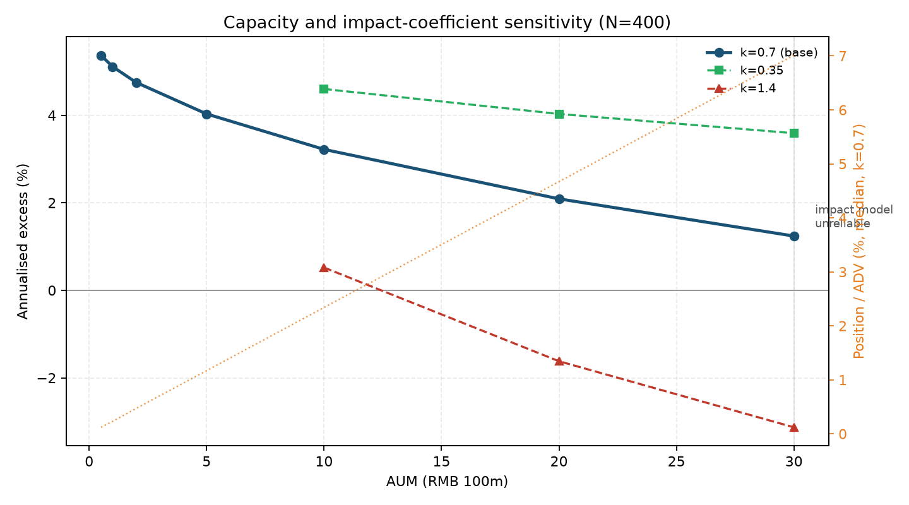

<div align="center">

# CSI 1000 Multi-Factor Research

**一个结论是否定的、但过程完整的中证 1000 因子研究**

`1,921 交易日` · `2,364 只标的` · `7 个方向` · `9 个因子`

</div>

---

## 这个项目在讲什么

我构建了一套完整的中证 1000 多因子管线，从点时数据到每日运行。
**结论是：这套组合的超额收益可以完全由规模与风格暴露解释，alpha 为 −4.45%（t = −2.63）。**

随后我用九个候选因子、七个研究方向去验证这个结论，全部失败。
**唯一站得住的改进不来自新因子，而来自组合宽度：持仓从 50 只扩大到 400 只，
IR 从 0.64 提到 1.32，容量从 2.3 亿提到 12–20 亿。**

<p align="center">
  
  
</p>

---

## 五个数字

| 指标 | 值 | 说明 |
|---|---:|---|
| **alpha（年化）** | **−4.45%**（t = −2.63） | 剥离规模/价值/低波后，组合在毁灭价值 |
| **对中证 1000 超额** | **8.05pp** | = 规模差 3.70 + 风格 4.25 + 残差 ≈ 0 |
| **IR（N=50 → N=400）** | **0.64 → 1.32** | 毛利不变（6.18 → 6.22pp），TE 减半、换手降 37% |
| **容量（N=400）** | **12–20 亿** | 逐股冲击成本；原配置 50 只为 2.3 亿 |
| **候选因子增量** | **0 / 9** | 残差 IC 最高 0.017，20% 权重下边际 \|t\| 最高 1.93 |

---

## 容量：这个策略真正的边界

<p align="center">
  
</p>

| AUM | k=0.35（乐观） | **k=0.7（基准）** | k=1.4（悲观） |
|---:|---:|---:|---:|
| 10 亿 | +4.60pp | +3.22pp | +0.52pp |
| 20 亿 | +4.03pp | **+2.09pp** | **−1.62pp** |
| 30 亿 | +3.59pp | +1.24pp | −3.13pp |

冲击系数 `k` 取自文献（0.7），**未做拟合**。平衡点对 k 呈平方敏感（k 翻倍则容量减为 1/4），
因此容量只能报区间：

- **悲观 k=1.4**：平衡点约 **12 亿**
- **基准 k=0.7**：20 亿处仍有 2.09pp；30 亿时单只持仓已达日均成交额 7%（p90 24%），
  冲击模型的「交易不影响价格」假设失效
- **综合可信区间：12–20 亿**（原配置 50 只：2.3 亿）

> 不报告拟合优度 R²：成本本就按平方根律生成，再拟合 `excess = G − c√AUM`
> 必然 R²≈1，属循环论证。真正的检验是上面的 k 扫描。

**执行口径同样构成约束**：改为次日开盘成交后，1 亿 AUM 超额由 5.11pp 降至 3.83pp，
IR 由 1.32 降至 0.89。原因是反转组合买入的股票在入场日隔夜抗跌约 2.8bp，
收盘成交可捕捉、开盘不可。

---

## 七个方向，全部关闭

| # | 方向 | 结果 |
|---|---|---|
| 1 | **价量因子**（复现 5 篇经典） | 论文频率 **4/4** 成立，组合增量 **0** |
| 2 | **持有期**（5/10/20 × 平滑） | **5 日最优**，gross 与 net 同步递减 |
| 3 | **基本面**（资产增长） | IC 0.0030，h 拉到 120 仍 t=1.61 → 伪信号 |
| 4 | **事件驱动**（SUE 独立组合） | 2019 起 **−2.52pp**；此前的 +3.43pp 是 2018 空仓假象 |
| 5 | **条件异质性**（市值×换手、上市年龄） | 钱在低换手桶、IC 在高换手桶；次新=小市值子集 |
| 6 | **状态依赖**（波动/动量/离散度） | 只有动量单调；overlay 一年翻转 17 次，不可交易 |
| 7 | **模型**（GBDT / OLS） | GBDT 在 1 亿下 **−1.03pp**；OLS 比等权差 1.4pp |

**三条反复出现的失败模式：**

1. 高换手 alpha 在现实成本下归零（4 次）
2. 拟合出来的权重不如等权（3 次）
3. 「超额变好」多半是 beta（3 条路径）

---

## 两个我自己抓出来的错误

- **组合边际测试的权重陷阱**：`composite + f` 让新因子获得约 80% 的方差权重。
  我据此得出「某因子毁掉 6 个点」，实际 4.8pp 是权重造成的。
- **样本起点错误变成免费择时**：SUE 在 2018 年无数据，组合空仓，而当年基准 −15.25%，
  制造出 +3.43pp 的假超额；剔掉 2018 后为 −2.52pp。

---

## 文档

| 文件 | 内容 |
|---|---|
| [`RESEARCH_REPORT.md`](RESEARCH_REPORT.md) | 完整研究报告 |
| [`FACTOR_ZOO.md`](FACTOR_ZOO.md) | 因子复现、频率依赖、条件异质性、七方向证据链 |
| [`RESEARCH_LOG.md`](RESEARCH_LOG.md) | 假设、决策、负结果、40 条工程教训 |
| [`PROJECT_STATUS.md`](PROJECT_STATUS.md) | 当前状态与交接说明 |
| [`PRODUCT_SHEET.pdf`](PRODUCT_SHEET.pdf) | 一页纸产品说明 |

---

## 快速复现

```bash
pip install -r requirements.txt
echo "TUSHARE_TOKEN=your_token" > .env

python 01_pull_history.py        # 约 60 分钟，可续跑
python 03_build_universe.py
python 04_build_factors.py
python 06_preprocess_factors.py
python 07_backtest.py            # 复现 9.65% / 714%
python 30_risk_attribution.py    # 复现 TE 7.06%
python 35_factor_zoo.py --diag   # 复现 4/4 与 0 增量
python 63_capacity.py            # 复现容量曲线与 k 敏感性
