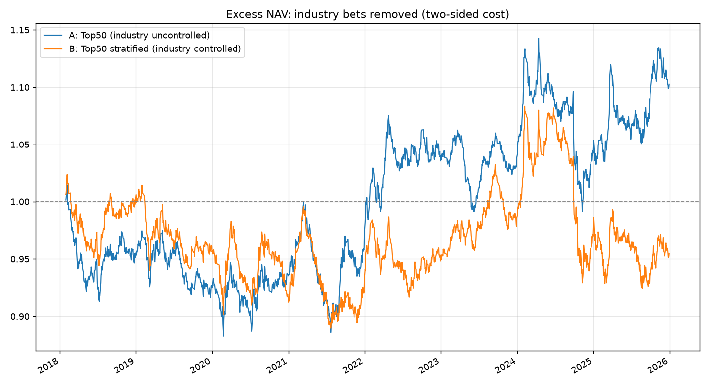
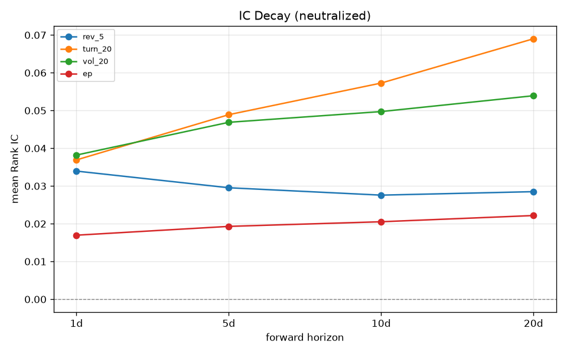

# CSI 1000 Cross-Sectional Equity Research

**A reproducible factor research pipeline for China A-shares**

`2018-01 — 2025-12` · `CSI 1000 universe` · `5-day rebalance`

---

> **TL;DR**
>
> 1. Built a point-in-time, survivorship-bias-free pipeline on CSI 1000 constituents (1,921 trading days, 945–998 stocks/day).
> 2. Four public factors produce **4.38% annual excess** (IR 0.66) and a long-short Sharpe of **1.47**.
> 3. **The excess is fully explained by value and low-volatility exposures.** Residual alpha is **−2.18%** (t = −1.35) before industry control and **−4.37%** (t = −2.91) after. **This is a smart-beta portfolio, not an alpha strategy.**
> 4. Two further candidates were built and rejected on pre-registered gates: **accruals** (orthogonal at 0.054, but IC 0.009 with sign flips in two years) and **PEAD/SUE** (orthogonal at 0.099, IC 0.023 with seven positive years — but **no significant portfolio improvement**, paired t = −0.27 / +0.66). Three attempts, no alpha found.

---

## Contents

- [1. Results](#1-results)
- [2. Core Finding](#2-core-finding-this-is-smart-beta-not-alpha)
- [3. Industry Neutralization](#3-industry-neutralization)
- [4. Negative Result: Buffer Rule](#4-negative-result-buffer-rule-does-not-help-here)
- [5. Phase 2: Two Candidates, Both Rejected](#5-phase-2-two-candidates-both-rejected)
- [6. Method](#6-method)
- [7. Factor Screening](#7-factor-screening)
- [8. Limitations](#8-limitations)
- [9. Roadmap](#9-roadmap)
- [10. Repository](#10-repository)
- [11. Reproduce](#11-reproduce)

---

## 1. Results

### 1.1 Long-only (net of cost)

| Variant | Ann. Return | Ann. Vol | Sharpe | Max DD | Calmar | Turnover | Cost | Ind. Dev (mean / max) |
|:---|---:|---:|---:|---:|---:|---:|---:|---:|
| **Equal Weight** | **9.79%** | 22.59% | 0.43 | −38.41% | 0.25 | 2394% | 2.87% | 7.37% / 17.50% |
| IC Weighted | 5.86% | 23.26% | 0.25 | −50.74% | 0.12 | 2773% | 3.33% | 8.98% / 20.19% |
| Orthogonalized | 5.75% | 22.27% | 0.26 | −39.75% | 0.14 | 2477% | 2.97% | 7.12% / 19.50% |
| EW + Buffer | 9.13% | 22.17% | 0.41 | −38.88% | 0.23 | 1214% | 1.46% | 6.93% / 15.49% |
| **EW + Stratified** | **8.09%** | 22.09% | 0.37 | −38.48% | 0.21 | 2473% | 2.97% | **1.26% / 1.35%** |
| *Benchmark (EW universe)* | *5.18%* | *24.63%* | — | — | — | — | — | — |

### 1.2 Excess vs benchmark

| Variant | Excess | Excess Vol | Info Ratio | Excess Max DD |
|:---|---:|---:|---:|---:|
| **Equal Weight** | **4.38%** | 6.61% | **0.66** | −10.66% |
| IC Weighted | 0.65% | 6.31% | 0.10 | −25.13% |
| Orthogonalized | 0.54% | 7.20% | 0.08 | −15.13% |
| EW + Buffer | 3.76% | 6.96% | 0.54 | −11.93% |
| **EW + Stratified** | **2.77%** | 6.78% | **0.41** | −11.98% |

### 1.3 Pure alpha (long-short diagnostic)

| Variant | Ann. | Vol | Sharpe | Max DD |
|:---|---:|---:|---:|---:|
| Equal Weight | 27.18% | 18.50% | **1.47** | −17.33% |
| IC Weighted | 14.22% | 18.09% | 0.79 | −18.61% |
| Orthogonalized | 15.14% | 18.57% | 0.81 | −17.73% |

> Individual-stock shorting is not implementable in A-shares. Shown for factor validation only.

### 1.4 Annual returns (net, %)

| | 2018 | 2019 | 2020 | 2021 | 2022 | 2023 | 2024 | 2025 |
|:---|---:|---:|---:|---:|---:|---:|---:|---:|
| Equal Weight | −15.25 | 13.06 | 9.66 | 16.95 | −3.00 | −0.26 | 2.97 | 28.28 |
| IC Weighted | −22.13 | 12.61 | 4.98 | 17.17 | −6.88 | 2.45 | 1.56 | 25.77 |
| Orthogonalized | −16.28 | 10.62 | 8.80 | 9.57 | −3.66 | −1.44 | 3.27 | 20.63 |
| EW + Buffer | −14.60 | 12.45 | 8.60 | 18.15 | −4.46 | 0.23 | 1.77 | 27.22 |
| EW + Stratified | −13.82 | 12.82 | 6.87 | 15.78 | −5.34 | 1.89 | 1.92 | 22.17 |

---

## 2. Core Finding: This Is Smart Beta, Not Alpha

Excess return regressed on style factor premiums (no market term):

| | A: industry uncontrolled | B: industry controlled |
|:---|---:|---:|
| **alpha (ann.)** | **−2.18%** | **−4.37%** |
| **alpha t-stat** | **−1.35** | **−2.91** |
| size β | 0.0004 (t=0.05) | −0.0024 (t=−0.35) |
| value β | **0.2845** (t=17.55) | **0.2701** (t=17.85) |
| low-vol β | **0.2879** (t=26.86) | **0.3378** (t=33.75) |
| R² | 0.554 | 0.629 |

Style factor premiums over the same window:

| Factor | Ann. Return |
|:---|---:|
| size (small − large) | 6.45% |
| value (high EP − low EP) | 7.78% |
| low-vol (low σ − high σ) | **13.08%** |

**Interpretation.** The entire 4.38% excess is value plus low-volatility exposure. Strip those two and the strategy returns nothing. An independent test — daily residualization of the composite score on size/value/volatility, rebalanced into a new portfolio — produces **−5.44% excess**, consistent with the regression result.

> Two different methods (portfolio construction and return-level regression) reach the same conclusion. The finding is robust.

---

## 3. Industry Neutralization

Top-N equal weighting leaves industry exposure uncontrolled: maximum deviation from the benchmark reaches **17.5%**, and the resulting portfolio is not a defensible product.

Replacing top-N with **stratified sampling** — quotas allocated to each industry bucket in proportion to its benchmark weight, stocks selected by score within each bucket — reduces the maximum deviation to **1.35%**.

| | Excess | Info Ratio | Ind. Dev (mean / max) |
|:---|---:|---:|---:|
| Top 50, equal weight | 4.38% | 0.66 | 7.37% / 17.50% |
| Top 50, stratified | 2.77% | 0.41 | **1.26% / 1.35%** |

**The 1.61 pp difference (37% of the original excess) was unintentional industry betting, not factor selection.**

### What industry control does *not* change

| Exposure | A (uncontrolled) | B (controlled) | Industry contribution |
|:---|---:|---:|---:|
| value β | 0.285 | 0.270 | **5%** |
| low-vol β | 0.288 | 0.338 | **−17%** (rose) |

Value and low-volatility loadings are **stock-level, not industry-driven**. Controlling industry does not remove them; if anything it makes the low-vol loading purer.

**Consequence:** residual alpha drops from −2.18% to −4.37% and becomes statistically significant. The industry bets in the uncontrolled portfolio were partly masking weak stock selection.

---

## 4. Negative Result: Buffer Rule Does Not Help Here

| | Turnover | Cost | Ann. Return |
|:---|---:|---:|---:|
| Top 50, no buffer | 2394% | 2.87% | **9.79%** |
| Top 50, buffer to 100 | 1214% | 1.46% | **9.13%** |

Turnover and cost both halved, yet net return fell 0.66%.

**Why.** The factor IC peaks at the 1-day horizon and decays ~70% within five days. Holding stale positions costs more alpha than the saved transaction cost. *Buffer rules suit slow-decaying factors, not fast ones.*

---

## 5. Phase 2: Two Candidates, Both Rejected

Having established that the excess is style exposure, the next question is whether additional factors carry independent information. Two candidates were selected for economic motivation and structural independence from price-based factors. Both were evaluated against gates fixed **before** the tests were run.

### 5.1 Accruals (Sloan 1996)

    accruals = (net income − operating cash flow) / average total assets   [TTM]
    factor   = −accruals                     (low accruals = high score)

Data: Tushare Pro `income` / `cashflow` / `balancesheet`. All point-in-time: earliest `f_ann_date` per period (no restatement look-ahead), latest of the three statements' announcement dates, `allow_exact_matches=False` so the signal only becomes tradable the day after disclosure. Banks, insurers and brokers dropped (`comp_type != '1'`).

Coverage **96.0%** of the panel. Cost: 17,088 API calls, 92 minutes with 8 threads.

| Test | Result | Gate | |
|:---|---:|---:|:---|
| Correlation with 4 factors | max **0.054** | < 0.30 | ✅ |
| Rank IC | **0.0093** | ≥ 0.02 | ❌ |
| ICIR | 0.140 | ≥ 0.30 | ❌ |
| Yearly IC sign | **2 of 8 years negative** | same sign | ❌ |
| Quintile monotonicity | Q5 < Q4 | monotone | ❌ |

The orthogonality is the interesting part: at 0.054, the accrual dimension is genuinely uncovered by the four price-based factors. But the signal has the wrong shape — IC is 0.0258 in 2018 and 0.0274 in 2023, but **−0.0068 in 2020 and −0.0069 in 2025**. Two full years with no signal.

Quintile means rise 6.2 → 20.6 bp from Q1 to Q4 and then **fall** to 17.8 bp, while the median is negative in all five buckets (−32 to −13 bp). The mean spread is carried by a few right-tail names, and the factor cannot distinguish them at the top.

**Rejected.** The line was closed without trying alternative denominators, horizons, or the sign.

### 5.2 PEAD / SUE

Built from the same statements, at zero additional API cost:

    single-quarter net income ni_q
      → YoY growth g = (ni_q_t − ni_q_{t−4}) / |ni_q_{t−4}|
      → SUE = (g_t − mean(g, last 8 quarters)) / std(g, last 8 quarters)
      → event date = f_ann_date, signal valid for 90 calendar days after disclosure

Effective test period 2019–2025 (SUE needs eight quarters of history). In-universe coverage **58.8%** — on any given day, about 40% of candidates have no recent announcement.

Cross-sectionally this looks considerably better than accruals:

| Test | Result | Gate | |
|:---|---:|---:|:---|
| Correlation with 4 factors | max **0.099** | < 0.30 | ✅ |
| IC, 5-day forward | 0.0142 | ≥ 0.02 | ❌ |
| **IC, 20-day forward** | **0.0229** | ≥ 0.02 | ✅ |
| IC, 60-day forward | 0.0297 | ≥ 0.02 | ✅ |
| Yearly IC (20-day) | **7 of 7 positive** | same sign | ✅ |
| Quintile means (20-day) | 9.6 → 17.3 → 19.8 → 20.4 → 26.9 bp | monotone | ✅ |
| Residual IC after regressing on the 4 factors | **0.0300** | ≥ 0.015 | ✅ |
| Composite ICIR, 4 → 5 factors | 0.462 → **0.538** | — | ✅ |

Residual IC exceeding raw IC is not a mistake: SUE correlates **negatively** with all four factors (−0.045 to −0.088) while all four have positive IC, so residualization removes a small drag. This also rules out "SUE is a repackaging of something we already have".

**The portfolio test is where it fails.**

| Construction | Excess | IR | Paired test vs baseline |
|:---|---:|---:|---|
| Equal Weight (4 factors) | 4.38% | 0.663 | — |
| **EW + SUE** | **3.96%** | **0.620** | t = −0.27, 95% CI [−2.75%, +2.06%] |
| EW + Stratified (4 factors) | 2.77% | 0.409 | — |
| **EW + SUE + Stratified** | **3.43%** | **0.533** | t = +0.66, 95% CI [−1.37%, +2.62%] |

And the industry-neutral 5-factor version does not beat the unconstrained 4-factor headline: **−1.01%, t = −0.63**.

**Why the cross-section looks good and the portfolio does not:**

1. **Turnover barely moves** (23.94% → 24.00%). The top-50 holdings are essentially unchanged. Stocks at the top of the four-factor composite carry ±2–3 z-scores on `rev_5` and `vol_20`; SUE's ±1 cannot reorder them.
2. **Horizon mismatch.** The portfolio rebalances every 5 days; SUE's signal lives on a 20–60 day scale. The signal never gets time to pay.
3. **58.8% coverage** means 40% of candidates receive no tilt at every rebalance, and Top-N truncation dilutes the rest.
4. **The improvement is concentrated.** Under the stratified construction, 2020 alone contributes +7.12 pp; 2022, 2023 and 2025 are all negative.

**Rejected.** No further variants were tested.

### 5.3 What the two failures have in common

| | Accruals | PEAD / SUE |
|---|---|---|
| Orthogonal to existing factors | ✅ 0.054 | ✅ 0.099 |
| Cross-sectional IC | ❌ 0.009 | ✅ 0.023 |
| Time-series stability | ❌ 2 years negative | ✅ 7 years positive |
| Portfolio improvement | — | ❌ not significant |
| **Failure mode** | **signal too weak** | **signal real, but untradeable at this horizon** |

The second failure is the more instructive one. **Cross-sectional significance is not the same as tradable excess return.** Between the two sit three walls: coverage, Top-N truncation, and rebalancing frequency. A factor can clear every statistical gate and still change nothing about which fifty stocks you own.

---

## 6. Method

**Data** — Tushare Pro: `daily`, `daily_basic`, `adj_factor`, `index_weight`, `stock_basic`, `namechange`, plus `income` / `cashflow` / `balancesheet` for Phase 2. 2018–2025.

**Universe** (rebuilt every trading day)

    CSI 1000 point-in-time constituents     (96 monthly snapshots)
      ∩ listed ≥ 60 trading days
      ∩ non-ST                                (from name-change history)
      ∩ traded that day                       (proxy for non-suspension)
      ∩ amount > 0

→ 945–998 stocks/day across 1,921 trading days.

**Factors (4)** — 5-day reversal · 20-day turnover · 20-day volatility · earnings yield (1 / PE_TTM)

All factors are sign-aligned so that higher is better: `rev_5 = −5d return`, `turn_20 = −20d mean turnover`, `vol_20 = −20d annualized σ`, `ln_mv = −ln(circulating market cap)`.

**Preprocessing** (daily cross-section)

    MAD winsorization (3 × 1.4826)
      → OLS residualization on industry dummies + log circulating market cap
      → z-score

**Composite** — equal weight. *IC-weighted and orthogonalized variants were tested and underperformed.*

**Portfolio** — top 50 equal-weighted · 5-day rebalance · one-way cost 12 bp

---

## 7. Factor Screening

Click to expand

| Factor | Raw IC | Neutralized IC | ICIR | Decision |
|:---|---:|---:|---:|:---|
| `rev_5` | 0.0160 | 0.0340 | 0.345 | keep |
| `turn_20` | 0.0168 | 0.0369 | 0.387 | keep |
| `vol_20` | 0.0173 | 0.0382 | 0.377 | keep |
| `ep` | 0.0070 | 0.0170 | 0.222 | keep (weak) |
| `ln_mv` | 0.0037 | — | 0.064 | drop → used as neutralizer |
| `mom_60` | −0.0077 | — | −0.098 | drop (A-share momentum is reversal) |
| `acc_ttm` | 0.0093 | — | 0.140 | **reject — §5.1** |
| `sue` (20d) | 0.0229 | — | 0.264 | **reject — §5.2** |

**Effect of neutralization:** mean Rank IC rises from **0.017** (raw) to **0.035** (neutralized). Most raw predictive power was masked by industry and size exposures.

---

## 8. Limitations

- **No alpha, after three independent attempts.** The excess is fully attributable to style exposures (§2); accruals failed on signal strength (§5.1); PEAD/SUE passed every statistical gate but produced no significant portfolio improvement (§5.2).
- **Industry classification is fine-grained** (136 categories), so stratified sampling cannot fully neutralize; residual deviation is 1.26% on average.
- **High turnover** (2394%/yr). A realistic market-impact model would erode roughly half of net return.
- **Low effective breadth.** `turn_20` and `vol_20` correlate at 0.665; the factor set is closer to 2.5 independent signals than 4.
- **Long-short is diagnostic only.** Individual A-share shorting is not feasible.
- **Industry classification is current, not point-in-time** (minor look-ahead).
- **Upstream data has known bad rows.** Beijing Stock Exchange (`.BJ`) `pct_chg` contains absurd values (max 200,400%, 3.0% of all rows). These tickers are outside CSI 1000 and do not enter the IC sample, but any full-market computation must filter to `.SH` / `.SZ`.
- **Fundamental data is as-reported-at-first-announcement**, so restated figures are not used. Conservative, but not identical to a vendor's point-in-time database.
- **The 5-day rebalance caps what slow signals can contribute.** Any factor whose information horizon exceeds one rebalancing cycle will be structurally diluted — this is a design constraint, not a data problem.

---

## 9. Roadmap

| | Item | Status |
|:---|:---|:---|
| Phase 1 | Factor research + attribution | ✅ complete |
| Phase 2a | Accruals factor | ❌ tested, rejected (§5.1) |
| Phase 2b | PEAD / SUE | ❌ tested, rejected (§5.2) |
| Phase 3 | Constrained construction: industry ±2%, size-neutral, turnover cap | next |
| — | Realistic market-impact model (square-root law) | planned |
| — | Alternative data (analyst revisions, money flow) | parked — requires a 10000-point Tushare tier |

**Repositioning after Phase 2.** With no alpha found across three attempts, the remaining value is not in factor discovery but in **delivery**: controlling exposures, halving turnover, and modelling impact honestly. Phase 3 therefore targets the same return with materially lower cost and a defensible risk profile, rather than searching for a fifth factor.

---

## 10. Repository

    01_pull_history.py         raw fetch (resumable, per-year parquet)
    02_pull_ref.py             stock list / delisted / name changes
    02b_pull_namechange.py     yearly chunking (10k row API cap)
    03_build_universe.py       point-in-time tradable universe
    04_build_factors.py        factor construction
    05_single_factor_test.py   IC / quintile / decay
    06_preprocess_factors.py   winsorize + neutralize + z-score
    07_backtest.py             composite + portfolio + cost + buffer + stratified
                               (v3 also runs the 5-factor comparison)
    08_attribution.py          A/B attribution (industry controlled vs not)
    09_style_neutral_test.py   style-neutral diagnostics
    10_pull_fina.py            Phase 2: three-statement fetch (8 threads, resumable)
    11_build_accruals.py       Phase 2a: YTD → quarter → TTM, accruals factor
    12_check_accruals.py       Phase 2a: correlation / IC / quintile gate
    14_build_pead.py           Phase 2b: single-quarter earnings, SUE factor
    15_check_pead_horizon.py   Phase 2b: IC at 5/20/60d, decay by days-since-announcement
    16_check_pead_marginal.py  Phase 2b: residual IC, composite comparison
    16b_check_selection.py     Phase 2b: subsample selection-bias check
    18_significance.py         Phase 2b: paired significance test
    RESEARCH_LOG.md            decisions, negative results, engineering lessons
    PROJECT_STATUS.md          current state, for handoff

---

## 11. Reproduce

    pip install -r requirements.txt
    echo "TUSHARE_TOKEN=your_token" > .env

    python 01_pull_history.py        # ~60 min, resumable
    python 02_pull_ref.py
    python 02b_pull_namechange.py
    python 03_build_universe.py
    python 04_build_factors.py
    python 05_single_factor_test.py
    python 06_preprocess_factors.py
    python 07_backtest.py
    python 08_attribution.py
    python 09_style_neutral_test.py

Phase 2 (optional — reproduces §5):

    python 10_pull_fina.py           # ~92 min, 8 threads, resumable
    python 11_build_accruals.py
    python 12_check_accruals.py
    python 14_build_pead.py
    python 15_check_pead_horizon.py
    python 16_check_pead_marginal.py
    python 16b_check_selection.py
    python 07_backtest.py            # rerun to include the 5-factor comparison
    python 18_significance.py

---

## Data & Disclaimer

Data via Tushare Pro. Independent research project for educational purposes, not investment advice. **No live trading record exists.**
