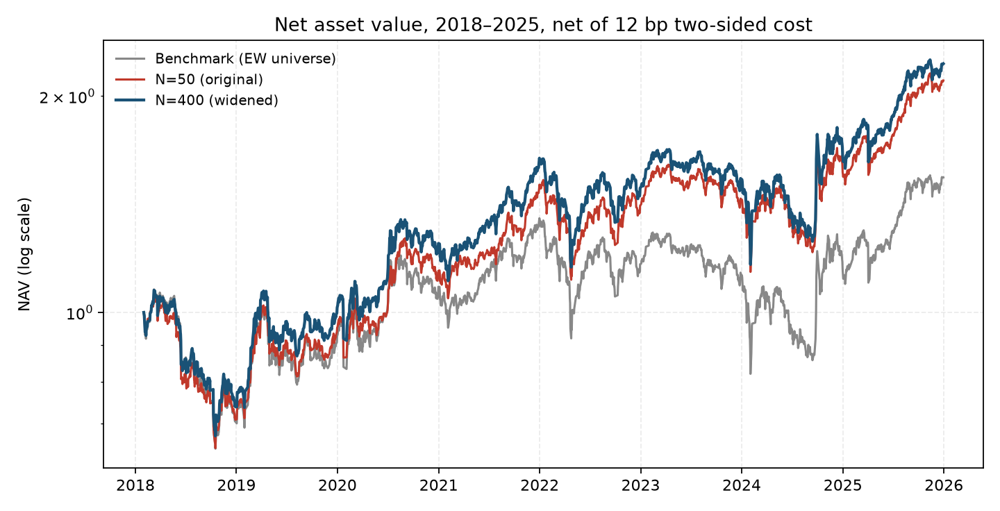
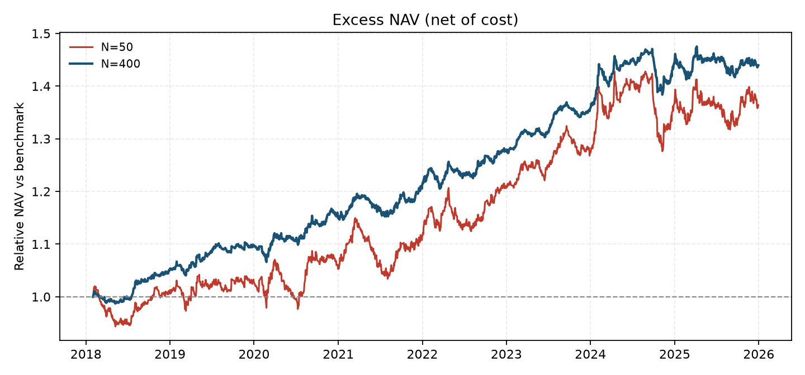

<div align="center">

# CSI 1000 Multi-Factor Research

**一个结论是否定的、但过程完整的中证 1000 因子研究**

`1,921 交易日` · `2,364 只标的` · `9 个方向` · `11 个候选因子（生产用 4 个）` · `4 层判据`

</div>

---

## 这个项目在讲什么

我构建了一套完整的中证 1000 多因子管线，从点时数据到每日运行。
**结论是：这套组合的超额收益可以完全由规模与风格暴露解释，alpha 为 −3.17%（t = −2.05）。**

随后我用 11 个候选因子、9 个研究方向去验证这个结论，全部失败。
**唯一站得住的改进不来自新因子，而来自组合宽度：持仓从 50 只扩大到 400 只，
IR 从 0.64 提到 1.32，容量从 2.3 亿提到 12–20 亿。**

归因链是闭合且可复现的：

    6.65pp（风格） − 3.17pp（alpha）        = 3.48pp（算术）
    3.48pp + 3.55pp（基准构造差）           = 7.03pp
    复利口径：4.25% + 3.64%                 = 8.05%

一条命令即可验证：`.venv/bin/python 30_risk_attribution.py --bridge-only`

<p align="center">
  
  
</p>

---

## 五个数字

| 指标 | 值 | 说明 |
|---|---:|---|
| **alpha（年化）** | **−3.17%**（t = −2.05） | 剥离规模/价值/低波后，组合在毁灭价值（p ≈ 0.04，边际显著） |
| **对中证 1000 超额** | **8.05pp** | = 基准构造 3.64 + 风格 4.25（复利，两列各自可加总） |
| **IR（N=50 → N=400）** | **0.64 → 1.32** | 毛超额 6.36 → 6.34pp（无单调趋势），TE −44%、换手 −37% |
| **容量（N=400）** | **12–20 亿** | 逐股冲击成本；原配置 50 只为 2.3 亿 |
| **11 个候选因子的四层通过率** | **7 / 4 / 0 / 1** | 正向显著(BH) / 经济门 / 5 日边际 / 换频率 |

> 口径：桥内用**算术**（日均 × 252），产品书用**复利**（净值比）。两者差 0.77pp，
> 各自可加总，**引用时不得混用**。

---

## 两条机制结论

**① 信息 2/3 集中在空头侧。**
六个统计显著因子的 `Q1−池` 绝对值是 `Q5−池` 的 2–4 倍（例如 rev_20：+3.8% vs −13.0%）。
A 股不能做空个股 → long-only 结构上只能拿到 16–34%。这解释了为什么 IC 0.02–0.05 的因子
在 long-only 下超额只有 1–4pp。

**② 最优持有期是 1 / 5 / 20 日并存。**
`vwap_dev` 的 IC 在 h=1 是 0.0495、h=5 掉到 0.0256；4 因子复合在 5 日最优；
`ovn_mom` 需要 20 日（5 日时成本吃掉 9.6pp）。
**不是因子不好，也不是 5 日不好——单一调仓周期只能容纳一个时间尺度。**

> `ovn_mom` 的隔夜/日内分解给出机制证据：Q5−Q1 隔夜 **+26.45%** / 日内 **−15.66%**。
> 收益全在隔夜腿，因此必须收盘建仓；但「只吃隔夜」需日频换手（24000%/年），
> 成本直接归零 → 20 日持有是「成本 vs 日内回吐」的折中。

---

## 容量：这个策略真正的边界

<p align="center">
  
</p>

k=0.7 的完整曲线（N=400）：**0.5 亿 +5.37 / 1 亿 +5.11 / 2 亿 +4.75 / 5 亿 +4.03 /
10 亿 +3.22 / 20 亿 +2.09 / 30 亿 +1.24pp**。

| AUM | k=0.35（乐观） | **k=0.7（基准）** | k=1.4（悲观） |
|---:|---:|---:|---:|
| 10 亿 | +4.60pp | +3.22pp | +0.52pp |
| 20 亿 | +4.03pp | **+2.09pp** | **−1.62pp** |
| 30 亿 | +3.59pp | +1.24pp | −3.13pp |

冲击系数 `k` 取自文献（0.7），**未做拟合**。平衡点对 k 呈平方敏感（k 翻倍则容量减为 1/4），
因此容量只能报区间：

- **悲观 k=1.4**：平衡点约 **12 亿**
- **基准 k=0.7**：30 亿处仍有 +1.24pp，但已远超有效区
- **模型失效点**：30 亿时单只持仓已达日均成交额 7%（p90 24%）
- **综合可信区间：12–20 亿**（原配置 50 只：2.3 亿）

> 0.5 亿时 N=400 的 5.37pp 高于扁平 12bp 的 5.15pp——因为此时实际单边成本约 9.4bp，低于假设的 12bp。

**执行口径同样构成约束**：改为次日开盘成交后，1 亿 AUM 超额由 5.11pp 降至 3.83pp，
IR 由 1.32 降至 0.89。原因是反转组合买入的股票在入场日隔夜抗跌约 2.8bp，
收盘成交可捕捉、开盘不可。

---

## 九个方向，全部关闭

| # | 方向 | 结果 |
|---|---|---|
| 1 | **价量因子**（复现 5 篇经典） | 论文频率显著 4/4（同向 3/4），组合增量 **0** |
| 2 | **持有期**（5/10/20 × 平滑） | **5 日最优**，gross 与 net 同步递减 |
| 3 | **基本面**（资产增长） | IC 0.0030，h 拉到 120 仍 t=1.61 → 伪信号 |
| 4 | **事件驱动**（SUE 独立组合） | 2019 起 **−2.52pp**；此前的 +3.43pp 是 2018 空仓假象 |
| 5 | **条件异质性**（市值×换手、上市年龄） | 钱在低换手桶、IC 在高换手桶；次新=小市值子集 |
| 6 | **状态依赖**（波动/动量/离散度） | 只有动量单调；overlay 一年翻转 17 次，不可交易 |
| 7 | **模型**（GBDT / OLS） | GBDT 在 1 亿下 **−1.03pp**；OLS 比等权差 1.4pp |
| 8 | **交易结构**（融资余额 / 大单） | 残差 IC 0.011（t 5.5）但 5 日并入 −1.29；大单方向反 |
| 9 | **组合优化**（均值方差 + 四类约束） | 风格暴露 2.1–2.8× 带宽、行业全松弛 → **现有约束集下不可行** |

**三条反复出现的失败模式：**

1. 高换手 alpha 在现实成本下归零（4 次）
2. 拟合出来的权重不如等权（3 次）
3. 「超额变好」多半是 beta（3 条路径）

---

## 六个我自己抓出来的错误

- **把 OLS 的零均值残差当成发现**：旧拆解表写「残差选股 ≈ 0」——带常数的回归其残差均值
  恒为零，这句话没有信息量。真正有信息的是 `alpha = −3.17%`。
  同表的 `2.5 + 1.7` 加起来是 7.9≠8.05，还与 alpha 冲突：三个数没有一个能对平。
  修法是把口径写死、让恒等式在代码里 `assert`（`alpha_bridge.csv`）。
- **组合边际测试的权重陷阱**：`composite + f` 让新因子获得约 **14.3%** 的方差权重（不是 20%，
  因为 composite 的截面 std 是 0.611）。按真 20% 校准后，旧表里的正边际全部被证伪。
- **样本起点错误变成免费择时**：SUE 在 2018 年无数据，组合空仓，而当年基准 −15.25%，
  制造出 +3.43pp 的假超额；剔掉 2018 后为 −2.52pp。
- **成本函数的每笔下单量写死 `1/50`**：加宽到 N=400 后，成本仍按 50 只组合的下单量计算，
  冲击项高估 √8 ≈ 2.8 倍，容量被低估一半（曾报 4.5 亿，实际 12–20 亿）。
  根因是同一个成本函数在三个脚本里各写了一遍。
- **用 `max` 判断数据口径**：`.BJ` 的 `pct_chg` 高达 200,400%，让一个本该通过的
  「是否小数」断言误报。判断口径要看中位数，`max` 只能用来发现脏数据。
- **恒等式容差按浮点精度定**：`pct_chg` 只有两位小数，5e-5 的舍入被当成「数据不一致」。
  正确做法是用 `pre_close` 重建收益做精确校验，把 `pct_chg` 降级为一致性体检。

---

## 文档

| 文件 | 内容 |
|---|---|
| [`PRODUCT_REPORT.md`](PRODUCT_REPORT.md) | 完整研究报告 |
| [`FACTOR_ZOO.md`](FACTOR_ZOO.md) | 11 因子 × 4 层判据、频率依赖、条件异质性、时间尺度错配 |
| [`RESEARCH_LOG.md`](RESEARCH_LOG.md) | 假设、决策、负结果、46 条工程教训 |
| [`PROJECT_STATUS.md`](PROJECT_STATUS.md) | 当前状态与交接说明 |
| [`PRODUCT_SHEET.md`](PRODUCT_SHEET.md) | 一页纸产品说明 |

---

## 快速复现

> **环境**：macOS + venv 在 `.venv`。终端提示符常同时显示 `(.venv) (base)`，
> 裸敲 `python` 可能落到 conda base —— **一律用 `.venv/bin/python`**。

```bash
.venv/bin/python -m pip install -r requirements.txt
echo "TUSHARE_TOKEN=your_token" > .env

.venv/bin/python 01_pull_history.py        # 约 60 分钟，可续跑
.venv/bin/python 03_build_universe.py
.venv/bin/python 04_build_factors.py
.venv/bin/python 06_preprocess_factors.py
.venv/bin/python 07_backtest.py            # 复现 9.65% / 714%
.venv/bin/python 30_risk_attribution.py --bridge-only   # ★ 复现收益桥（约 1 分钟）
.venv/bin/python 30_risk_attribution.py    # 复现 TE 7.10%
.venv/bin/python 35_factor_zoo.py --diag   # 复现 4/4 与 0 增量
.venv/bin/python 49_topn_verify.py         # 复现 N=50→400 的 TE/IR 与逐股成本
.venv/bin/python 63_capacity.py            # 复现容量曲线与 k 敏感性（约 15 分钟）
.venv/bin/python 63_capacity.py --replot   # 从已存 CSV 重画，约 20 秒
.venv/bin/python 73_constraint_ab.py       # 复现换约束集重测（Q5−池 / 时间尺度）
.venv/bin/python 74_evaluate.py --all-cache --no-deep   # 11 因子统一评估台（约 7 分钟）
.venv/bin/python 74_evaluate.py --bh                   # BH-FDR（11 个试验，去重）
.venv/bin/python 77_intraday_daily.py      # 复现 clv/vwap_dev + 隔夜日内分解
